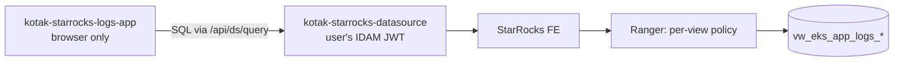

# Kotak Grafana plugins for StarRocks

Two Grafana plugins, built and released separately from one repository.

| Folder | Plugin | What it is |
|---|---|---|
| [`plugins/kotak-starrocks-datasource`](plugins/kotak-starrocks-datasource) | `kotak-starrocks-datasource` | Backend data source (Go + React). Queries StarRocks **as the signed-in user** by forwarding their IDAM JWT, so Ranger enforces per-user access. In UAT/prod. |
| [`plugins/kotak-starrocks-logs-app`](plugins/kotak-starrocks-logs-app) | `kotak-starrocks-logs-app` | Frontend-only app **Logs Drilldown (StarRocks)**: the Logs Drilldown experience for StarRocks log views (`vw_eks_app_logs_<app_id>`), with a picker for the data source (one per StarRocks database) and the view. Sends all queries through the data source above, unchanged. |



## Layout

```
plugins/kotak-starrocks-datasource/   own package.json, go.mod, scripts, docs, e2e
plugins/kotak-starrocks-logs-app/     own package.json, scripts, docs, e2e
pipelines/                            parametrized Azure DevOps template + one pipeline per plugin
scripts/build-plugin.sh               local equivalent of the pipeline for one plugin folder
```

The plugins share nothing at build time. Both must stay in sub-folders: the scaffolded webpack config finds
plugins with `**/src/**/plugin.json`, so a plugin at the repository root would pick up the other one.

## Build

```bash
scripts/build-plugin.sh plugins/kotak-starrocks-datasource   # npm + Go tests, frontend + linux binaries, zip, verify
scripts/build-plugin.sh plugins/kotak-starrocks-logs-app     # npm tests, frontend, zip, verify
```

Each plugin's own README covers development and end-to-end tests. The app's architecture guide, readable on a phone:
[`plugins/kotak-starrocks-logs-app/docs/architecture`](plugins/kotak-starrocks-logs-app/docs/architecture/README.md). Org rollout instructions for the app (for
the Claude session on the org PC): [`ORG_AGENT_PROMPT.md`](plugins/kotak-starrocks-logs-app/docs/ORG_AGENT_PROMPT.md)
(0.1.0), then [`ORG_AGENT_PROMPT_3_UPGRADE_0.3.0.md`](plugins/kotak-starrocks-logs-app/docs/ORG_AGENT_PROMPT_3_UPGRADE_0.3.0.md)
(0.1.0 → 0.3.0 in one patch: data source picker and the Logs Drilldown look; supersedes prompt 2).
