# kotak-starrocks-datasource: what was built and how it works

> **Who this is for.** The engineer who owns the plugin, as a single reference for what was done and why.
> For TLT and management, use the short version, [`MANAGEMENT_BRIEF.md`](MANAGEMENT_BRIEF.md).
>
> **How it is ordered.** Bottom to top. It starts with the problem, then climbs the stack one layer at a time:
> StarRocks and Ranger, IDAM tokens, the MySQL wire protocol, the plugin, Grafana, and the configuration
> screen. After that it covers how the plugin is built, delivered and provisioned, and ends with the UAT
> status as of 2026-10-29.
>
> **Status labels.** **Verified** means a test, a source check or a UAT run showed it. **Reported** means it
> comes from the org rollout log or another team and was not re-checked here. **Open** means it is not known
> yet.
>
> **Diagrams** are Mermaid. GitHub, Azure DevOps wikis and VS Code's Markdown preview (with a Mermaid
> extension) render them.

---

## Contents

0. [Answer for today: why the UAT datasource fails](#0-answer-for-today-why-the-uat-datasource-fails)
1. [The problem](#1-the-problem)
2. [The whole system on one page](#2-the-whole-system-on-one-page)
3. [Layer 1: StarRocks and Ranger, where access is decided](#3-layer-1-starrocks-and-ranger-where-access-is-decided)
4. [Layer 2: IDAM tokens, who the user is](#4-layer-2-idam-tokens-who-the-user-is)
5. [Layer 3: the MySQL wire protocol and the driver patch](#5-layer-3-the-mysql-wire-protocol-and-the-driver-patch)
6. [Layer 4: the plugin backend](#6-layer-4-the-plugin-backend)
7. [Layer 5: Grafana, how the token reaches the plugin](#7-layer-5-grafana-how-the-token-reaches-the-plugin)
8. [Layer 6: the configuration screen](#8-layer-6-the-configuration-screen)
9. [One query, end to end](#9-one-query-end-to-end)
10. [Build: from source to a verified zip](#10-build-from-source-to-a-verified-zip)
11. [Delivery: from the feed to a running Grafana](#11-delivery-from-the-feed-to-a-running-grafana)
12. [Provisioning: the UAT datasources](#12-provisioning-the-uat-datasources)
13. [Status on 2026-10-29](#13-status-on-2026-10-29)
14. [Troubleshooting: error, cause, owner](#14-troubleshooting-error-cause-owner)
15. [Decision log](#15-decision-log)
16. [Limitations and risks](#16-limitations-and-risks)
17. [Next steps](#17-next-steps)
18. [Where everything is](#18-where-everything-is)
19. [Glossary](#19-glossary)

### The layers at a glance

Read from the bottom up. Each layer depends only on the ones below it.

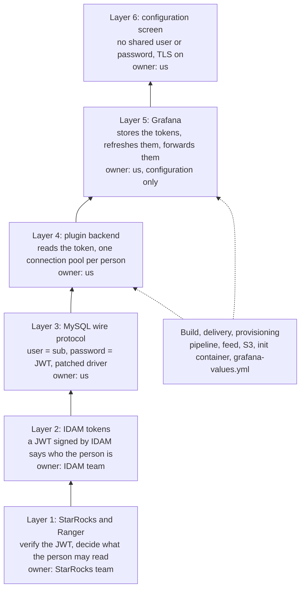

---

## 0. Answer for today: why the UAT datasource fails

**What happened.** In UAT Explore, `SELECT CURRENT_USER()` on `app-logs-observability-db-idam` returned:

```
db query error: Error 5204 (42000): Access denied; you need (at least one of) the ANY privilege(s) on
DATABASE obs2_logs1_uat for this operation.
```

**Short answer: the opaque access tokens are not the cause.** This datasource sends the **ID token**
(`tokenSource: id_token`). An OIDC ID token is always a JWT, whatever the access-token setting is. The error
is in fact good news: it shows that login succeeded and Ranger refused access.

**Why 5204 proves login worked** (verified in the StarRocks source):

| Fact | Source (StarRocks repo) |
|---|---|
| 5204 is `ERR_ACCESS_DENIED_FOR_EXTERNAL_ACCESS_CONTROLLER`. StarRocks raises it only when the catalog uses an external access controller, which here is Ranger. StarRocks' own RBAC uses 5203 instead, with a "Current role(s)" hint that this message lacks | `fe/fe-spi/src/main/java/com/starrocks/common/ErrorCode.java`, `fe/fe-core/src/main/java/com/starrocks/authorization/AccessDeniedException.java` (`reportAccessDenied`) |
| During login, StarRocks authenticates first. Only after that succeeds does it switch to the default database (`changeCatalogDb`), and that switch needs at least one privilege on the database | `fe/fe-core/src/main/java/com/starrocks/mysql/MysqlProto.java` (`authenticate`) |
| A failed JWT check would return 5208 ("No authentication was successful in the authentication chain"), not 5204 | `ErrorCode.java` |

So every step up to Ranger works in UAT:

1. Grafana forwarded the user's ID token.
2. The plugin read `sub` from the token.
3. TLS to the FE verified against the Kotak CA.
4. StarRocks verified the JWT against the IDAM signing keys and created a session for the user.
5. Ranger evaluated that user and denied access.

This also shows, for the first time, that the plugin's login works against StarRocks **4.1.6**. Before this,
it had been tested only on 4.0.10.

**Why even `SELECT CURRENT_USER()` fails.** The datasource sets a default database (`obs2_logs1_uat`).
StarRocks checks that database during login, before any query runs. So no query works through this
datasource, not even Save & test, until Ranger grants the user something in `obs2_logs1_uat`. The rollout log
says "a first Save & test needs none", but that holds only for a datasource with no default database.

**What to do:**

1. **Ask the StarRocks/Ranger team** to add the tester's user to a Ranger policy, as a lowercase `kmbl…`
   name (the `sub` claim), with at least `SELECT` on one table or view in `obs2_logs1_uat`. Any privilege on
   the database or on an object in it passes the login check. A tenant role that holds `SELECT` on views is
   the intended setup.
2. **Optional: see the user name before the grant.**
   - The StarRocks team can read it in the FE log. Look for the line
     `Set database [obs2_logs1_uat] failed during negotiate, user=…`.
   - The Ranger audit log shows the denied request with the user name.
   - Or use an editable test datasource in Grafana (for example `kotak-starrocks-datasource-3`). Set the host
     to `uat.observability.logs.kotak.internal:9030` and **leave Database empty**. Turn on *With CA Cert*,
     paste the Kotak CA, and set *Server name* to `uat.observability.logs.kotak.internal`. Then press **Save
     & test**. It should report `Connected to StarRocks as 'kmbl…'@'…'`, because with no default database
     the login does not need a Ranger grant.
3. **Switching IDAM access tokens from opaque to JWT is still worth doing**, but only for the temporary
   twin datasource `app-logs-observability-db-idam-at` (`tokenSource: access_token`).
   - Until the switch, that twin is expected to fail inside the plugin with
     `the IDAM access_token cannot be used: it is not a JWT (opaque token?)`. It never reaches StarRocks.
   - It matters because of the 60-minute question in [§4.4](#44-the-60-minute-question). If the ID token
     cannot be renewed, the access token is the fallback.

---

## 1. The problem

Today every StarRocks datasource in Grafana is a built-in `mysql` datasource. Each logs in with one
read-only user per application, whose password Grafana reads from a mounted secret file. StarRocks
therefore sees the application user, never the person:

- **No per-person access control.** Everyone who can open the datasource sees everything that application
  user can see.
- **No accountability.** StarRocks audit logs show the shared user, not who ran the query.
- **Shared secrets.** One password per application lives in Grafana's configuration.

The org plan is for StarRocks to validate the user's IDAM JWT and for Apache Ranger to enforce per-user and
per-role policies. The Grafana side needs to send *the signed-in person's* identity to StarRocks on every
query. This project is that Grafana side. The StarRocks, Ranger and IDAM configuration belongs to other
teams.

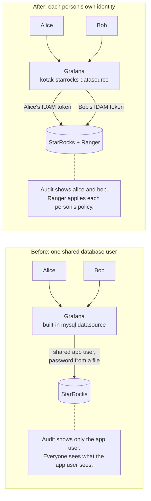

**Constraints that shaped the design:**

- **No core Grafana changes** (org plan). The org's Grafana image wraps the official `grafana-oss` image
  (12.0.1-security-01), so changing the built-in `mysql` plugin would need a from-source Grafana build. The
  work is therefore an **external plugin with its own ID**, delivered through the existing S3 plugin path.
- The existing `mysql` datasources and dashboards must not change.
- The plugin's owner controls only the Grafana side, so every choice that depends on StarRocks (token type,
  username claim) is a setting.

---

## 2. The whole system on one page

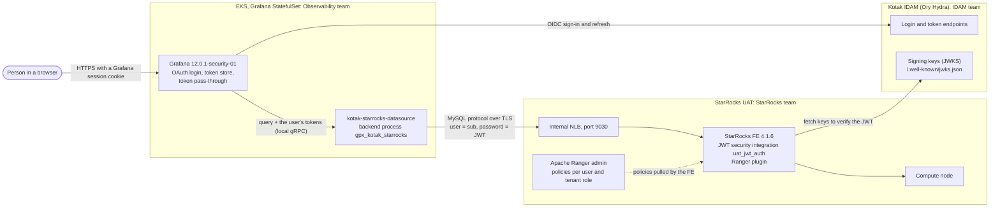

| Component | Owner | Role in this design |
|---|---|---|
| Kotak IDAM (Ory Hydra) | IDAM team | Signs users in. Issues the ID token (JWT), the access token (opaque by default) and the refresh token. Publishes the signing keys |
| Grafana 12.0.1-security-01 on EKS | Observability (us) | Signs users in through generic OAuth and stores their tokens on the server. Forwards them to the datasource when `oauthPassThru` is on |
| `kotak-starrocks-datasource` | Observability (us) | New plugin, the code in this repo. Turns the forwarded token into a StarRocks login for that person |
| StarRocks FE | StarRocks team | Verifies the JWT and runs the session as the person |
| Apache Ranger | StarRocks team | Decides what that person may read |

---

## 3. Layer 1: StarRocks and Ranger, where access is decided

The bottom layer is where security is enforced. The plugin does not decide access. It only makes sure
StarRocks knows who is asking.

### 3.1 How StarRocks accepts a JWT as a login

StarRocks (3.5 and later) supports **JWT security integrations**. The StarRocks team creates one and adds it
to the authentication chain. **Reported** for UAT (branch `branch-apache-ranger-setup` of
`obser-aws-obs2-logging-deploy-config`, not merged):

| Setting | UAT value | Meaning |
|---|---|---|
| Security integration | `uat_jwt_auth`, `type = authentication_jwt` | How StarRocks verifies JWTs |
| `jwks_url` | the IDAM JWKS (`/.well-known/jwks.json`) | Where the public keys come from. Fetched on **every new connection**, with no cache (**verified** in the 4.0.10 source) |
| `principal_field` | `sub` | Which claim must equal the MySQL user name. The comparison ignores case, and the session runs as the name the client sent (**verified**) |
| `required_audience` | not set | `aud` is not checked |
| `required_issuer` | **Open** (QUESTIONS S1) | If set, it must match exactly. The IDAM issuer has a trailing slash |
| `authentication_chain` | `native,uat_jwt_auth` (set at runtime with `ADMIN SET FRONTEND CONFIG`) | Native users first, then JWT |
| FE JVM truststore | includes the Kotak CA | The FE must trust the IDAM certificate to fetch the JWKS over HTTPS |
| TLS on 9030 | forced. Certificate from "KotakGroup - Standalone", SAN `uat.observability.logs.kotak.internal` (**verified** live) | Protects the token in transit |

Other StarRocks facts the plugin depends on (all **verified** in the 4.0.10 source and by a local test):

- JWT integrations switch the client to the `authentication_openid_connect_client` auth plugin. They do not
  accept `mysql_clear_password` ([§5](#5-layer-3-the-mysql-wire-protocol-and-the-driver-patch)).
- Only RSA keys are supported, and the key must carry a `kid`. IDAM uses RS256 with two keys per
  environment (**reported**, live discovery).
- `exp` is checked **only at login**. An open connection outlives its token unless the client closes it,
  which is why the plugin ties connection lifetime to token expiry ([§6.3](#63-per-user-connection-pools)).

### 3.2 What happens inside StarRocks at login

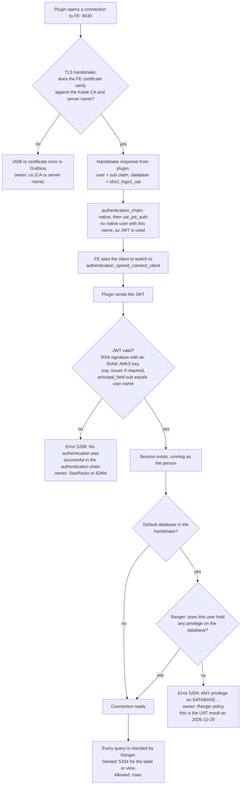

### 3.3 Ranger

- In StarRocks UAT, Ranger is the **external access controller** for the default catalog. Policies are
  defined per tenant, as roles on views (**reported**).
- There is **no user sync** from IDAM to Ranger yet (Day 2 of the org plan). Every human user must be added
  to Ranger by hand, under the name StarRocks sees, which is the lowercase `sub` such as `kmbl…`.
- Error codes the user can see (**verified** in source):

| Code | Name | Meaning here |
|---|---|---|
| 5208 | `ERR_AUTHENTICATION_FAIL_IN_AUTH_CHAIN` | Login failed: the JWT was not accepted, or the integration or chain is missing |
| 5204 | `ERR_ACCESS_DENIED_FOR_EXTERNAL_ACCESS_CONTROLLER` | Login succeeded, **Ranger** denied the action |
| 5203 | `ERR_ACCESS_DENIED` | Login succeeded, StarRocks' **own** RBAC denied the action (catalogs without Ranger, such as the local test setup) |

---

## 4. Layer 2: IDAM tokens, who the user is

### 4.1 The three tokens

Grafana receives these when a user signs in through IDAM. **Reported** from the IDAM docs and live
discovery.

| Token | Format | Lifetime | Used by the plugin? |
|---|---|---|---|
| **ID token** | Always a **JWT** (signed RS256) | 60 min | **Yes, the default** (`tokenSource: id_token`). `aud` is the Grafana client ID |
| **Access token** | **Opaque** by default (`ory_at_…`). A JWT only if the Grafana IDAM client uses `accessTokenStrategy=jwt`, which needs IRM approval | 10 min | Optional (`tokenSource: access_token`). Must be a JWT |
| **Refresh token** | Opaque | 8 h | Never sent to the plugin. Grafana uses it to get new tokens |

An opaque token is a random string that only IDAM can look up. StarRocks cannot verify it offline, so it
cannot be a StarRocks login.

### 4.2 The claims that matter

| Claim | Example | Used for |
|---|---|---|
| `sub` | `kmbl…` (lowercase) | The StarRocks user name (`usernameClaim: sub`). Must match `principal_field` and the Ranger user name |
| `user_name` | `KMBL…` (uppercase) | Not used. StarRocks would accept it, because the principal check ignores case, but Ranger names are lowercase |
| `exp` | Unix time | The plugin closes the user's connections before this time |
| `iss` | `https://uat.api.idam.kotak.internal/` (trailing slash) | Checked by StarRocks if `required_issuer` is set |
| `aud` | Grafana client ID (ID token) | Not checked in UAT (no `required_audience`) |

The plugin **does not verify** the signature. It only reads `sub` and `exp`. StarRocks verifies everything,
because it is the enforcement point. The tokens come from Grafana's server-side token store, never from the
browser ([§7.1](#71-token-pass-through)).

### 4.3 Sign-in and refresh

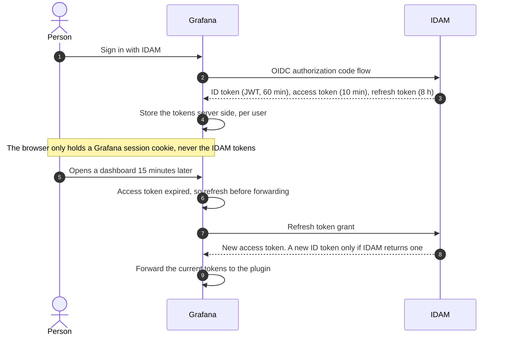

### 4.4 The 60-minute question

Grafana refreshes when **either** token has expired (`needTokenRefresh` in Grafana's `oauth_token.go`). The
IDAM docs say the refresh response contains **no new ID token** (QUESTIONS I5, **open**). If that is right:

- The **ID token** datasource works for the first 60 minutes after sign-in. After that the plugin receives
  an expired ID token and answers
  `the IDAM token has expired and Grafana could not refresh it: sign out of Grafana and sign in again`.
- The **access token** keeps being renewed every 10 minutes, so an `access_token` datasource would keep
  working. That is only possible once IDAM issues **JWT** access tokens to the Grafana client.

For this reason UAT has two datasources, one per token type ([§12](#12-provisioning-the-uat-datasources)). A
joint test longer than 60 minutes decides which one stays.

---

## 5. Layer 3: the MySQL wire protocol and the driver patch

StarRocks speaks the MySQL protocol on port 9030. The plugin connects with the standard Go MySQL driver
(`go-sql-driver/mysql`). The user name is the `sub` claim and the password is the JWT. The detail below is
the one place the stock driver failed.

### 5.1 The login conversation

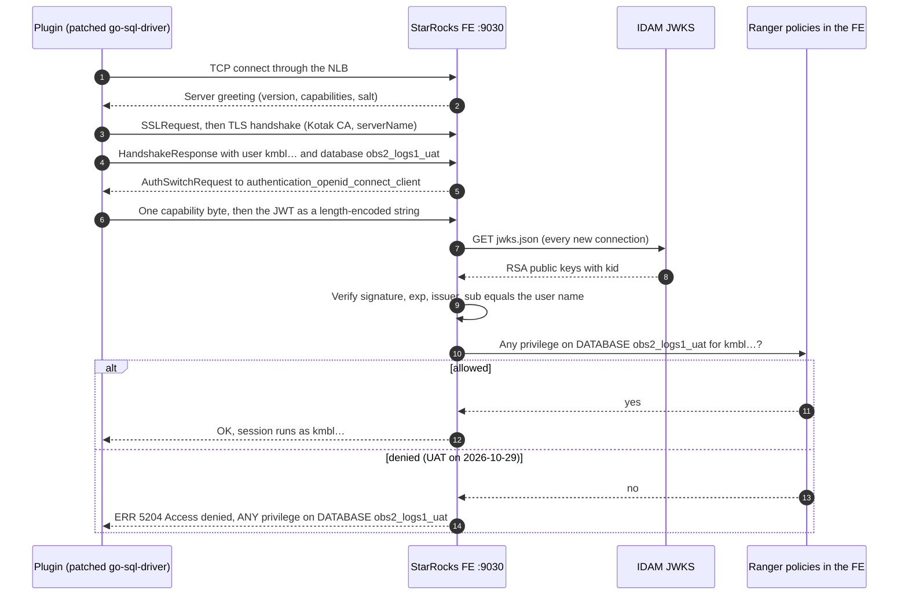

### 5.2 Why the driver is patched

- The original plan was to send the JWT with `mysql_clear_password`. StarRocks **rejects** that for JWT
  users (**verified** in the source and by a local test).
- StarRocks sends an `AuthSwitchRequest` for `authentication_openid_connect_client`. It expects the reply
  `[1 byte capability][length-encoded token]`.
- Upstream `go-sql-driver/mysql` v1.10.0 does not know that plugin and fails with "unknown auth plugin".
- The fix is a vendored copy of v1.10.0 with a patch of about 10 lines, in
  `third_party/go-sql-driver-mysql/`. Every hunk is marked `[kotak patch]` and explained in `KOTAK_PATCH.md`.
  - `auth.go` answers the new plugin.
  - `dsn.go` adds `Config.AllowOpenIDConnect`, off by default.
  - `errors.go` adds `ErrOpenIDConnect`.
  - `auth_test.go` adds two tests.
- `go.mod` uses it through `replace github.com/go-sql-driver/mysql => ./third_party/go-sql-driver-mysql`.
  **Never remove that line.** Without it, the build succeeds but every login fails.
- The plugin also allows `mysql_clear_password` and native passwords, in case StarRocks is ever configured
  to ask for them.

---

## 6. Layer 4: the plugin backend

The backend is a fork of Grafana 12.0.1's built-in MySQL datasource. The query editor, macros
(`$__timeFilter` …) and result handling are unchanged. **Only authentication and connection pooling
differ.**

### 6.1 Code map

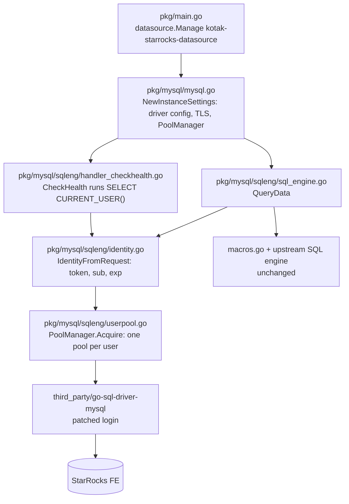

### 6.2 Reading the identity (`identity.go`)

Grafana attaches two headers to every request from a signed-in IDAM user
([§7.1](#71-token-pass-through)): `Authorization: Bearer <access token>` and `X-Id-Token: <ID token>`.

1. Pick the token. `tokenSource: id_token` (default) reads `X-Id-Token`. `access_token` reads
   `Authorization` and strips `Bearer `.
2. Decode the JWT payload **without verifying it**.
3. Return `Username = claims[usernameClaim]` (default `sub`), `Token = the raw JWT` and `Expiry = exp`.

| Problem | Message the user sees |
|---|---|
| No token | `no IDAM token on this request: sign in to Grafana through IDAM (alerting, service accounts and basic-auth users are not supported by this datasource)` |
| Opaque token | `the IDAM access_token cannot be used: it is not a JWT (opaque token?)` |
| Claim missing | `the IDAM id_token has no string claim "sub" to use as the StarRocks username` |
| No `exp` | `the IDAM id_token has no exp claim` |

### 6.3 Per-user connection pools

A MySQL connection is authenticated once, as one user. A shared pool would run Bob's query on a connection
that logged in as Alice. The plugin therefore keeps **one small pool per user, per datasource**
(`userpool.go`):

- The pool key is the StarRocks user name.
- Size: `maxConnsPerUser`, default 5.
- Idle connections close after `connMaxIdleSeconds`, default 60. That is below the roughly 350 s idle timeout
  of the NLB, so the NLB never cuts a connection the plugin still thinks is open.
- A connection's lifetime is `min(connMaxLifetime, time until the token expires)`. StarRocks checks `exp`
  only at login, so this is what stops a connection from outliving its token.
- Each request takes a **lease** on the pool. A pool marked for retirement closes only after its last
  request finishes.

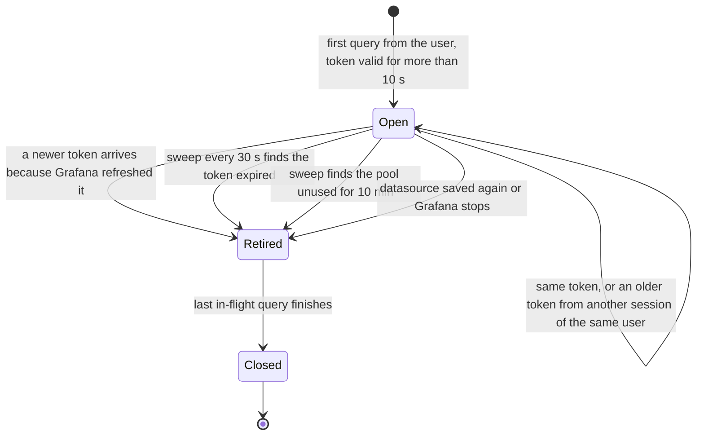

A token with less than 10 seconds left is refused before any connection opens, with the "token has expired"
message from [§4.4](#44-the-60-minute-question).

### 6.4 Queries, health check and errors

- **QueryData** resolves the user's pool once per request. It then runs the request's queries on it with the
  unchanged upstream engine.
- **Save & test (CheckHealth)** runs `SELECT CURRENT_USER()` as the signed-in user and reports
  `Connected to StarRocks as 'kmbl…'@'…' using the IDAM id_token (claim sub=kmbl…, token expires in …)`. It
  must be run by someone signed in through IDAM.
- **Errors.**
  - StarRocks auth errors (5208) and any server message containing "access denied" (5203, 5204, MySQL
    1044/1045/1142/1143/1227) are passed through unchanged, so users see that StarRocks or Ranger refused
    them.
  - Syntax, unknown-column and unknown-table errors are also shown.
  - Any other server error is replaced by Grafana's generic message and logged.
- **`CURRENT_USER()` and `SHOW GRANTS`** are allowed in queries. Upstream blocks them to hide the shared
  database user, which no longer exists here, and they help users debug Ranger decisions.

### 6.5 Security rules built into the code

- **TLS is always on.**
  - With *With CA Cert* the FE certificate is checked against that CA. Without it, the system roots are used.
  - The only way to send a token without TLS is the *Allow plaintext connection* switch. It exists only for
    the local test container, and the plugin logs a warning when it is on.
- **Tokens are never logged.** The connection is built as a driver `Config` struct, not a DSN string, so the
  token never appears in a string that could end up in a log. Pool logs carry the user name and the time to
  expiry only.
- **Nothing is stored.** Tokens live only in memory, as connection credentials.
- **Only the configured token is sent to StarRocks.** Grafana forwards both tokens to the plugin.
- The session time zone setting is validated against `^[A-Za-z0-9_/+:-]+$`, because it is sent as SQL.

### 6.6 Logs

Grafana shows plugin logs under the logger `plugin.kotak-starrocks-datasource`.

| Level | Message | When |
|---|---|---|
| Warn | `Cannot resolve StarRocks identity` | No token, opaque token, missing claim, or expired token |
| Warn | `allowPlaintext is enabled…` / `oauthPassThru is disabled…` | Misconfiguration |
| Error | `Query error` | A server error that is hidden from the user |
| Debug | `Opened StarRocks connection pool` / `Retiring StarRocks connection pool` (with `starrocksUser`, reason) | Pool lifecycle |

Debug lines appear only with a Grafana log filter such as `plugin.kotak-starrocks-datasource:debug`. A 5204
from Ranger is shown to the user and is **not** logged by the plugin. Use the StarRocks FE log or the Ranger
audit log for those.

---

## 7. Layer 5: Grafana, how the token reaches the plugin

### 7.1 Token pass-through

Grafana 12.0.1 already has the mechanism. The plugin only switches it on. **Verified** in the Grafana source
([`research/07`](research/07-grafana-12-internals-reference.md)) and end to end.

1. `ClearAuthHeadersMiddleware` deletes every auth header the browser sent, so **a user cannot inject
   someone else's token**.
2. `OAuthTokenMiddleware` runs if the datasource has `jsonData.oauthPassThru: true`. It loads the signed-in
   user's tokens from Grafana's store, refreshes them first if they have expired, and sets
   `Authorization: Bearer <access>` and `X-Id-Token: <id>` on QueryData and CheckHealth.
3. The plugin reads those headers through the SDK (`req.GetHTTPHeader`).

**Who gets no token, and therefore cannot use this datasource:**

- **Alert rules.** There is no browser request, so the middleware does nothing. The plugin declares
  `alerting: false`, and Grafana shows "Alerting: Not supported".
- Service accounts and API keys.
- Basic-auth users, such as the local `admin`.
- Public dashboards, and anything else that runs without a signed-in IDAM user.

### 7.2 How Grafana loads the plugin

- The plugin is **unsigned**. Grafana loads it only because `grafana.ini` has
  `plugins.allow_loading_unsigned_plugins: kotak-starrocks-datasource`.
- The plugin page shows an "Invalid plugin signature" banner. That is expected for an allowed unsigned
  plugin.
- `plugin.json`:
  - id `kotak-starrocks-datasource`, name **StarRocks (IDAM identity)**
  - executable `gpx_kotak_starrocks`, `backend: true`
  - `alerting: false`
  - `grafanaDependency: >=12.0.0`
- The zip carries Linux amd64 and arm64 binaries. Grafana starts the one for its platform as a separate
  process and talks to it over local gRPC.

### 7.3 Grafana settings in UAT that matter (reported, `grafana-values.yml`)

- `auth.generic_oauth`
  - `use_refresh_token: true`
  - `login_attribute_path: sub`
  - Org mapping: every IDAM user is a **Viewer** in org 3 (Kotak-All) and an Editor in org 2 (Playground).
    `GrafanaAdmin` is an Admin everywhere.
- Feature toggle `accessTokenExpirationCheck: true`.
- `plugins.public_key_retrieval_disabled: true` and `check_for_plugin_updates: false`, so Grafana never
  contacts grafana.com about plugins.

---

## 8. Layer 6: the configuration screen

The top layer is what an admin sees under **Connections → Data sources**. The editor is a reworked copy of
the MySQL one (`src/configuration/ConfigurationEditor.tsx`).

- **No user or password fields.** Every query runs as the signed-in person. A blue info box says so.
- `oauthPassThru` is **forced on** when the editor opens, because without it Grafana forwards nothing.
- Sections and fields:

| Section | Field | Key | Default | Note |
|---|---|---|---|---|
| Connection | Host URL | `url` | — | `host:9030`, no scheme |
| | Database name | `jsonData.database` | — | Optional. If set, Ranger must grant the user something in it ([§0](#0-answer-for-today-why-the-uat-datasource-fails)) |
| IDAM identity | Token sent to StarRocks | `jsonData.tokenSource` | `id_token` | `access_token` needs JWT access tokens |
| | Username claim | `jsonData.usernameClaim` | `sub` | Must match `principal_field` and Ranger names |
| TLS | With CA Cert | `jsonData.tlsAuthWithCACert` + `secureJsonData.tlsCACert` | off | **On in every real environment** |
| | Server name | `jsonData.serverName` | host from URL | Must be in the FE certificate SAN |
| | Use TLS Client Auth | `jsonData.tlsAuth` | off | Only if StarRocks requires mTLS |
| | Skip TLS Verification | `jsonData.tlsSkipVerify` | off | Never outside local testing |
| Additional | Session timezone | `jsonData.timezone` | — | `Asia/Kolkata` or `+05:30` |
| | Min time interval | `jsonData.timeInterval` | — | |
| Connection limits | Max connections per user | `jsonData.maxConnsPerUser` | 5 | Number |
| | Idle connection timeout (s) | `jsonData.connMaxIdleSeconds` | 60 | Below the NLB idle timeout |
| | Max connection lifetime (s) | `jsonData.connMaxLifetime` | 14400 | Always capped by token expiry |
| Local development | Allow plaintext connection | `jsonData.allowPlaintext` | off | Local container only |

- The upstream `user`, `password`, `maxOpenConns`, `maxIdleConns` and `allowCleartextPasswords` keys are
  ignored.
- The query editor is unchanged. It is copied from `@grafana/sql` 12.0.1 into `src/sql`, because that
  version is not on public npm.
- `react/jsx-runtime` is bundled, because Grafana 12.0 does not share it with plugins.

---

## 9. One query, end to end

The full path, top to bottom, for a person who runs a query in Explore or on a dashboard panel:

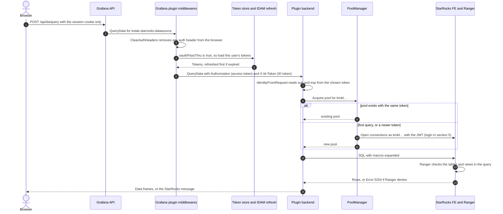

---

## 10. Build: from source to a verified zip

### 10.1 What the build produces

`kotak-starrocks-datasource-<version>.zip` (about 18 MB), with one top-level folder
`kotak-starrocks-datasource/` containing:

- `plugin.json`, `module.js` and the other frontend files, `LICENSE` and `img/logo.svg`;
- `gpx_kotak_starrocks_linux_amd64` and `gpx_kotak_starrocks_linux_arm64`, static Go binaries built with
  `CGO_ENABLED=0` and `-tags arrow_json_stdlib`, with build info stamped in.

A `.sha256` file accompanies the zip. `scripts/verify-package.sh` is the release gate. Its 15 checks cover
the layout, the ID and version (no `%VERSION%` placeholder left), `alerting: false`, both binaries present
and executable inside the zip, static ELF for the right architecture, and the checksum.

### 10.2 The org pipeline (reported)

```mermaid
flowchart LR
  repo["Repo kotak-custom-grafana-plugins<br/>branch feature/kotak-starrocks-pipelines<br/>vendor/ committed"] --> t
  subgraph ci["Azure DevOps on CI_Shared_Linux"]
    direction TB
    t["Tool check<br/>Go 1.26, Node 20 or bundled Node 24"] --> npm["npm ci through kmbl-public-mirror"]
    npm --> fe["Frontend: typecheck, lint,<br/>57 tests, webpack build"]
    fe --> go["Backend: go vet, go test,<br/>patched driver tests,<br/>GOFLAGS=-mod=vendor GOPROXY=off"]
    go --> bin["Static binaries,<br/>linux amd64 and arm64"]
    bin --> pkg["package.sh: zip and sha256"]
    pkg --> ver["verify-package.sh: 15 checks"]
    ver --> att["security-attestation stage<br/>secret scan, SBOM, Semgrep"]
  end
  att --> gate{"Release approval gate<br/>tag v0.1.0"}
  gate --> feed["Azure Artifacts feed Observability<br/>kotak-starrocks-datasource 0.1.0"]
```

- **Offline Go.** There is no Go module mirror in the org and the builders cannot reach the internet. The
  `vendor/` folder (about 40 MB) is therefore committed, and Go builds with `GOFLAGS=-mod=vendor
  GOPROXY=off`.
- **npm** goes through the org mirror `kmbl-public-mirror` with `npmAuthenticate@0`.
- **Pipelines** live in `pipelines/`:
  - `starrocks-datasource-ci.yml` builds and tests every change.
  - `starrocks-datasource-release.yml` publishes to the feed behind an approval gate.
  - `templates/build-steps.yml` holds the steps both share.
  - `starrocks-datasource-docker.yml` is a build-only fallback.
- **Security.** The pipelines reuse the org `security-attestation` stage (v1.4.3, `isTestRun: true`,
  contract `sbom-only`). The scan found no secrets, an SBOM of 528 components and 71 Semgrep findings, none
  of them blocking. The `CBOM_Analysis` and `SCA_Attestation` logs were never seen.
- **Results.** The CI run and a release dry run are green, at about 2.5 to 3 minutes each. Zip hashes differ
  per build (timestamps), so always quote the published hash.
- Recipes for building elsewhere (offline bundle, Docker, native) are in
  [`BUILD_PIPELINE_GUIDE.md`](BUILD_PIPELINE_GUIDE.md).

---

## 11. Delivery: from the feed to a running Grafana

Plugins reach Grafana through the same path the org already uses for the Loki, Metrics and Traces apps.
Nothing is baked into the image.

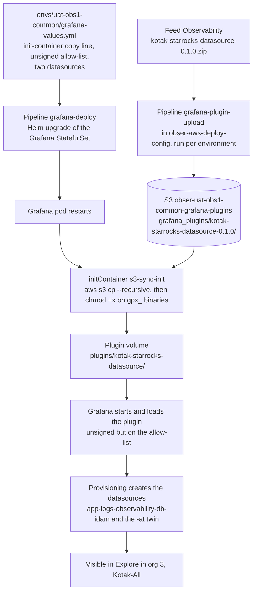

Details (**reported**):

- The upload pipeline's dropdown value is `kotak-starrocks-datasource-0.1.0|0.1.0`. The zip must be the
  **only** file in the published feed folder, because the upload pipeline copies everything it finds.
- S3 does not keep the executable bit, so the init container runs `chmod +x` on `gpx_*`. Without that,
  Grafana cannot start the backend.
- The first UAT upload failed with "Bucket … does not exist or you do not have access". The bucket exists.
  The cause was the access of the `GrafanaS3UploadUat` service connection, which the owner fixed.
- Dev upload and deploy were skipped on purpose; UAT was tested directly. The dev lines are in the
  deploy-config branch but not deployed.
- **Rollback.**
  - Remove the datasource entries, the init-container line and the allow-list line, then redeploy.
    `datasources.yaml` has `prune: true`, so removed entries are deleted.
  - For a bad version, point the init-container line back at the previous S3 folder.
  - The existing `mysql` datasources are never touched.

---

## 12. Provisioning: the UAT datasources

Both are added to `envs/uat-obs1-common/grafana-values.yml` on branch `feature/kotak-starrocks-datasource`
of `obser-aws-deploy-config`. They are deployed to UAT from that branch; the PR to `main` is not merged yet.

```yaml
# StarRocks logs queried as the signed-in IDAM user
- name: app-logs-observability-db-idam
  uid: app01961-ds-starrocks-obs-logs-public        # {appid}-ds-{type}-{appname}-{public|private}, at most 40 chars
  type: kotak-starrocks-datasource
  access: proxy
  orgId: 3                                          # Kotak-All, where IDAM users are Viewers
  editable: false
  url: uat.observability.logs.kotak.internal:9030
  jsonData:
    database: obs2_logs1_uat                        # forces a Ranger check on this database at login (section 0)
    oauthPassThru: true                             # Grafana forwards tokens only when this is true
    tokenSource: id_token
    usernameClaim: sub
    maxConnsPerUser: 5
    connMaxIdleSeconds: 60
    tlsAuthWithCACert: true
    serverName: uat.observability.logs.kotak.internal   # in the FE certificate SAN, checked live
  secureJsonData:
    tlsCACert: $__file{/mnt/grafana-secrets/domain-kotak-cacerts}   # issuer KotakGroup - Standalone

# TEMPORARY twin for the token-type test: keep whichever survives the 60-minute test
- name: app-logs-observability-db-idam-at
  uid: app01961-ds-starrocks-obs-logs-public-at
  # … identical, except:
  jsonData:
    tokenSource: access_token
```

In the same file, under `grafana.ini.plugins`:

```yaml
allow_loading_unsigned_plugins: kotak-starrocks-datasource
```

**Who can test it.** Both datasources are in org 3, where non-admins are Viewers. Viewers may not have
Explore. Test as a `GrafanaAdmin` user who signed in **through IDAM** (not the local admin), or add copies to
org 2 (Playground), where IDAM users are Editors.

---

## 13. Status on 2026-10-29

```mermaid
flowchart LR
  classDef done fill:#d3f9d8,stroke:#2b8a3e,color:#000
  classDef next fill:#fff3bf,stroke:#e67700,color:#000
  classDef later fill:#e9ecef,stroke:#868e96,color:#000
  a["Plugin built and tested<br/>locally"]:::done --> b["Org CI and release<br/>pipelines green"]:::done
  b --> c["Published to feed,<br/>uploaded to UAT S3"]:::done
  c --> d["UAT Grafana loads plugin<br/>and both datasources"]:::done
  d --> e["ID token forwarded,<br/>TLS to FE verified"]:::done
  e --> f["StarRocks accepts the JWT,<br/>session as the person"]:::done
  f --> g["Ranger policy for<br/>the test user"]:::next
  g --> h["Query returns rows<br/>as the person"]:::next
  h --> i["60-minute test,<br/>choose the token type"]:::next
  i --> j["Merge PRs, then<br/>prod and DR"]:::later
```

Green is done, amber is next, grey is later.

| Area | State | Evidence |
|---|---|---|
| Plugin code, unit and frontend tests | **Verified** | Go tests, 57 frontend tests, lint clean |
| Local end to end (Grafana 12.0.1 + mock IDAM + StarRocks 4.0.10) | **Verified** | Save & test as the OAuth user, 40 concurrent queries across 4 users, refresh reconnects ([`research/08`](research/08-implementation-summary-and-test-evidence.md)) |
| Org pipelines | **Reported** green | CI run and release dry run on `CI_Shared_Linux` |
| UAT delivery (S3, init container, allow-list, provisioning) | **Reported** working | Plugin page and both datasources visible in UAT |
| UAT JWT login against StarRocks 4.1.6 | **Verified** 2026-10-29 | Error 5204 is only possible after a successful login ([§0](#0-answer-for-today-why-the-uat-datasource-fails)) |
| Ranger allow and deny for a real user | **Open** | Needs a Ranger policy for the tester |
| Which token type survives 60 minutes | **Open** | Needs the joint 60-minute test. Needs JWT access tokens for the `-at` twin |
| StarRocks audit shows the human user | **Open** | StarRocks team to confirm |
| Signed plugin, arm64 at runtime, prod, DR | **Open** | Later |

---

## 14. Troubleshooting: error, cause, owner

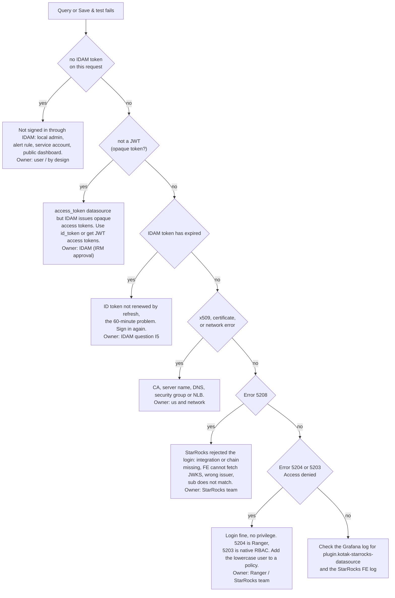

| Message | Cause | Fix | Owner |
|---|---|---|---|
| `no IDAM token on this request…` | Not an IDAM session (local admin, alert, service account, public dashboard), or `oauthPassThru` false | Sign in through IDAM. Alerts are not supported | User / by design |
| `the IDAM access_token cannot be used: it is not a JWT (opaque token?)` | `tokenSource: access_token` with opaque IDAM access tokens | Use `id_token`, or have IDAM switch the Grafana client to JWT access tokens | IDAM |
| `the IDAM token has expired and Grafana could not refresh it…` | The ID token expired and refresh did not renew it | Sign out and in. The long-term fix is the token-type decision | IDAM (I5) / us |
| `x509: certificate signed by unknown authority` or `…not valid for…` | Wrong CA, or the server name is not in the SAN | Check `tlsCACert` and `serverName` | Us |
| `Network error: Failed to connect…` | DNS, security group or NLB | Check the route from the Grafana pod to the FE on 9030 | Network |
| `Error 5208 … No authentication was successful in the authentication chain` | JWT rejected: integration or chain missing, the FE does not trust the IDAM CA (JWKS fetch fails), wrong `required_issuer`, or `sub` does not match | The StarRocks team checks `SHOW SECURITY INTEGRATIONS`, the chain and the FE log | StarRocks |
| `Error 5204 … ANY privilege(s) on DATABASE …` | Login fine. No Ranger privilege on the default database | Add the user to a Ranger policy with something in that database | Ranger |
| `Error 5204 … SELECT privilege(s) on TABLE/VIEW …` | Login fine. No Ranger privilege on that object | Ranger policy, or query an allowed view | Ranger |
| `Error 5203 … Current role(s): NONE` | Same as 5204, on a catalog without Ranger | StarRocks `GRANT` | StarRocks |
| `StarRocks requested an auth plugin the driver refused` | Built without the patched driver (the `replace` line is missing) | Restore the `go.mod` `replace` and rebuild | Us |

---

## 15. Decision log

### 15.1 Plugin design (this repo, `AGENT_GUIDE.md` §2.3)

| # | Decision | Why |
|---|---|---|
| P1 | External plugin with a new ID, not a patch to the built-in `mysql` | No core Grafana changes. The org image wraps the official binary. Existing datasources stay untouched |
| P2 | Use Grafana's `oauthPassThru` | Grafana's middleware forwards tokens only for this key. The editor forces it on |
| P3 | Patched go-sql-driver | StarRocks JWT logins need `authentication_openid_connect_client`, which upstream lacks |
| P4 | One pool per user | A MySQL connection is one user's session |
| P5 | Connection lifetime capped by token expiry | StarRocks checks `exp` only at login |
| P6 | ID token by default | Always a JWT. Access tokens are opaque by default |
| P7 | Bundle `react/jsx-runtime` | Grafana 12.0 does not share it |
| P8 | `@grafana/sql` copied into `src/sql` | Version 12.0.1 is not on public npm |
| P9 | TLS always, CA-verified | The token is a bearer credential |
| P10 | `alerting: false` | Alert evaluation has no user token |
| P11 | `CURRENT_USER()` and `SHOW GRANTS` allowed | Lets users see their own identity when debugging Ranger |
| P12 | The plugin does not verify JWT signatures | StarRocks is the enforcement point, and tokens come only from Grafana's server-side store |

### 15.2 Org rollout (reported; D1–D13 in the org's `IMPLEMENTATION_AND_DECISIONS.md`)

| # | Decision | Why |
|---|---|---|
| R1 | One PR to `main`, opened only after the POC works | Owner's policy. The working-log branch stays private |
| R2 | Pipelines in `pipelines/` | Matches `obser-aws-deploy-config` |
| R3 | `vendor/` committed, offline Go build | No Go mirror; builders are internet-restricted (same as node-exporter) |
| R4 | npm through `kmbl-public-mirror` | Org convention |
| R5 | One build job on `CI_Shared_Linux`. A two-step fallback (npm on one host, Go on the offline build server) is documented but not built | The pool has Go 1.26.10 and Node 20.19.6 or a bundled Node 24.14.1. The build passes on both |
| R6 | Tool check prefers the agent's bundled newer Node | Agents in the pool differ |
| R7 | Reuse the org `security-attestation` stage (v1.4.3, `isTestRun: true`, `sbom-only`) | Org template. No new secrets |
| R8 | Release through the existing approval environment `nodeexporter-aix_uat`, tag `v<version>` | Reuse for now. A dedicated environment is still to do |
| R9 | Unsigned plugin plus `allow_loading_unsigned_plugins` for dev and UAT. Signing is wired but off | A private signature needs a Grafana Cloud account and token, which were not available. This is a one-line `grafana.ini` change |
| R10 | `usernameClaim: sub` | `principal_field = sub`. `sub` and Ranger names are lowercase |
| R11 | `id_token` default, plus a temporary `access_token` twin in UAT | The 60-minute question ([§4.4](#44-the-60-minute-question)) |
| R12 | Org repo history rebuilt to remove an expired sample token | Secrets must not sit in git. Trees were verified identical |
| R13 | No new infrastructure for the UAT bucket | It already exists |

---

## 16. Limitations and risks

| Item | Impact | Mitigation |
|---|---|---|
| No alerting, service accounts or public dashboards | Those features cannot use this datasource | By design: no user, no token. Keep the existing `mysql` datasources for them |
| The ID token may not be renewed by refresh | Queries fail about 60 minutes after sign-in | The 60-minute test. Fallback: JWT access tokens (IRM approval) |
| Ranger users are added by hand | Onboarding does not scale | Day 2 of the org plan: IDAM-to-Ranger sync |
| JWTs cannot be revoked | A token stays valid until `exp` (up to 60 min) after sign-out | Short token lifetime; TLS everywhere |
| StarRocks fetches the JWKS on every new connection | Load on IDAM, and logins fail if IDAM is down | Per-user pools reuse connections; the 60 s idle timeout limits reconnects |
| Patched MySQL driver | Must be re-applied when the driver is upgraded | About 10 lines, marked `[kotak patch]`, with tests |
| Unsigned plugin | Needs the allow-list in each environment | Decide on a private signature before prod |
| Tested on StarRocks 4.0.10 locally, 4.1.6 in UAT (login only) | Unknown behaviour in other versions | Rerun the integration test on upgrades |
| Release reuses another team's approval environment and `isTestRun: true` | Not production-grade governance yet | Dedicated environment and real attestation before prod |

---

## 17. Next steps

1. **Ranger grant.** The StarRocks/Ranger team adds the tester (lowercase `kmbl…`) with `SELECT` on a view in
   `obs2_logs1_uat`. Then, in UAT Explore, signed in through IDAM:
   - `SELECT CURRENT_USER()` should return `'kmbl…'@'…'`;
   - `SHOW DATABASES` should list only what Ranger allows;
   - a count on the allowed view should return a number;
   - a query on a view outside the policy should return 5204.
2. **Confirm the audit trail.** The StarRocks team checks that the FE audit log shows the person, not a
   shared user.
3. **IDAM.** Get JWT access tokens for the Grafana client (in progress) and the answer to I5 (is the ID token
   renewed on refresh?).
4. **60-minute test** with both datasources. Keep the token type that survives, delete the other datasource,
   and drop the `-at` suffix.
5. **Merge.** First the deploy-config PR (it already runs in UAT from the branch), then the single PR from
   `feature/kotak-starrocks-pipelines` to `main`.
6. **Before prod:** the signing decision, a dedicated release environment, `isTestRun: false` with the real
   attestation contract, a DR bucket mapping, then prod and DR.

---

## 18. Where everything is

| What | Where |
|---|---|
| Public reference repo (this one) | `github.com/sirjebbington/grafana-custom-mysql-plugin` |
| Org plugin repo | Azure DevOps `Observability/_git/kotak-custom-grafana-plugins`. `feature/kotak-starrocks-pipelines` is the only branch that goes to `main`; `chore/org-rollout-log` is the private working log |
| Org deploy change | `obser-aws-deploy-config`, branch `feature/kotak-starrocks-datasource` |
| Package | Feed `Observability`, `kotak-starrocks-datasource-0.1.0.zip`, version 0.1.0 |
| Plugin design, build, test, deploy | [`AGENT_GUIDE.md`](AGENT_GUIDE.md) |
| Build recipes (offline, Docker, native) | [`BUILD_PIPELINE_GUIDE.md`](BUILD_PIPELINE_GUIDE.md) |
| Questions for IDAM and StarRocks | [`QUESTIONS.md`](QUESTIONS.md) |
| Research and test evidence | [`research/`](research/README.md) |
| Management summary | [`MANAGEMENT_BRIEF.md`](MANAGEMENT_BRIEF.md) |

---

## 19. Glossary

| Term | Meaning |
|---|---|
| **IDAM** | Kotak's identity provider (Ory Hydra). Signs people in and issues tokens |
| **OIDC** | OpenID Connect, the sign-in protocol between Grafana and IDAM |
| **JWT** | JSON Web Token. A signed token anyone can verify with the issuer's public key, without calling the issuer |
| **Opaque token** | A random string that only the issuer can look up. It cannot be verified offline |
| **ID token** | The OIDC token that says who signed in. Always a JWT |
| **Access token** | The token for calling APIs. Opaque in IDAM unless the client is switched to JWT |
| **Refresh token** | Lets Grafana get new tokens without asking the person to sign in again |
| **JWKS** | The issuer's published public keys, used to verify JWT signatures |
| **`sub` claim** | The subject: the person's ID in the token (`kmbl…`) |
| **`oauthPassThru`** | Grafana datasource setting: forward the signed-in user's OAuth tokens to the datasource |
| **FE / CN** | StarRocks frontend (SQL, login, planning) and compute node |
| **Security integration** | StarRocks object describing an external login method, here JWT |
| **Authentication chain** | The order in which StarRocks tries login methods |
| **Ranger** | Apache Ranger, the policy engine deciding who may read what |
| **NLB** | AWS Network Load Balancer in front of the FE |
| **Init container** | A container that runs before Grafana starts. Here it copies plugins from S3 |
| **Provisioning** | Grafana creating datasources from configuration files at startup |
| **Unsigned plugin** | A plugin without a Grafana signature. It loads only if listed in `allow_loading_unsigned_plugins` |
