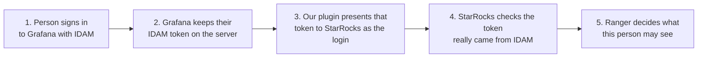
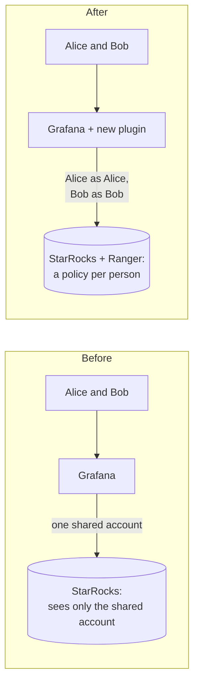

# Per-person access to StarRocks from Grafana: brief for TLT and management

**Status as of 29 Oct 2026 · Observability team · UAT proof of concept**

> The engineering detail behind every statement here is in
> [`IMPLEMENTATION_EXPLAINED.md`](IMPLEMENTATION_EXPLAINED.md).

---

## In one paragraph

Today Grafana reads StarRocks logs through **one shared database account per application**. StarRocks
cannot tell who ran a query, and everyone with access to a dashboard sees everything that account can see.
We built a Grafana plugin that makes **every query run as the person who is signed in**, using their
existing IDAM login. StarRocks verifies the identity, and **Apache Ranger decides what that person may
see**. The plugin is deployed in **UAT**. On 29 Oct the first real query proved the identity chain works
from the browser all the way to Ranger. **The remaining step for a first successful query is a Ranger
access policy for the test users**, which the StarRocks team owns.

---

## Why this matters

| Today | With this change |
|---|---|
| One shared StarRocks account per application, password stored in Grafana configuration | No database passwords in Grafana. Each person logs in with their own IDAM identity |
| Everyone who can open a dashboard sees all of that application's data | Ranger applies each person's own policy (least privilege) |
| StarRocks audit logs show the shared account | Every query is attributable to a named person |
| Access rules split between Grafana and StarRocks | One place for data access rules: Ranger. Other tools can reuse it later |

**What does not change:**

- Existing Grafana datasources and dashboards. The new datasource sits next to them.
- Grafana itself. There is no change to Grafana's code, only a plugin and configuration.
- How people sign in to Grafana.

---

## How it works

The plugin never decides access itself. It only makes sure StarRocks knows **who** is asking. Security is
enforced by StarRocks and Ranger.

---

## Where we are

```mermaid
flowchart LR
  classDef done fill:#d3f9d8,stroke:#2b8a3e,color:#000
  classDef next fill:#fff3bf,stroke:#e67700,color:#000
  classDef later fill:#e9ecef,stroke:#868e96,color:#000
  a["Plugin built<br/>and tested"]:::done --> b["Build pipeline with<br/>security scan"]:::done
  b --> c["Deployed to<br/>UAT Grafana"]:::done
  c --> d["Identity reaches StarRocks<br/>and is accepted"]:::done
  d --> e["Ranger policy<br/>for test users"]:::next
  e --> f["First query returns<br/>data as the person"]:::next
  f --> g["60-minute session test"]:::next
  g --> h["Production<br/>and DR"]:::later
```

Green is done, amber is next, grey is later.

| Milestone | Status |
|---|---|
| Plugin built; automated tests pass; full flow tested on a local copy of Grafana and StarRocks | ✅ Done |
| Org build and release pipelines, with the org's security attestation (secret scan, SBOM, code scan) | ✅ Done. All green, no blocking findings |
| Delivered to UAT through the existing plugin path (feed → S3 → Grafana) | ✅ Done |
| A person's IDAM identity is forwarded, encrypted, and accepted by StarRocks in UAT | ✅ Proven 29 Oct |
| Ranger policy for test users, so a first query returns data | ⏳ Next. StarRocks/Ranger team |
| Confirm StarRocks audit logs show the person's name | ⏳ Next. StarRocks team |
| Sessions longer than 60 minutes (token renewal) | ⏳ Next. IDAM change in progress, then a joint test |
| Production and DR | ⬜ After UAT sign-off |

### What the 29 Oct result means

The first UAT query came back with **"Access denied … on DATABASE obs2_logs1_uat"** (StarRocks error 5204).
That is the expected answer for a person who has no Ranger policy yet. StarRocks returns this error only
**after** it has verified the person's IDAM login, and only when Ranger is the one refusing. So everything
up to Ranger works: Grafana, the plugin, the encrypted connection, the IDAM token check, and StarRocks
recognising the person. Once Ranger grants access, data should flow.

---

## What is left, and who owns it

| # | Item | Owner | Blocking? |
|---|---|---|---|
| 1 | Add test users to Ranger with read access to one view in the UAT logs database | StarRocks/Ranger team | **Yes**, for the first successful query |
| 2 | Switch Grafana's IDAM client to signed (JWT) access tokens | IDAM team (IRM approval) | Only for sessions longer than 60 minutes |
| 3 | Answer whether IDAM renews the ID token on refresh | IDAM team | Decides which token type we keep |
| 4 | 60-minute joint test, then keep one of the two UAT datasources | Observability + StarRocks | Before prod |
| 5 | Merge the two pull requests (plugin repo, deploy configuration) | Observability | Before prod |
| 6 | Production release governance: dedicated approval environment, production attestation contract | Observability + DevOps | Before prod |
| 7 | Plugin signing decision for production | Management / Observability | Before prod |
| 8 | Automatic IDAM → Ranger user sync (Day 2 of the plan) | StarRocks/Ranger + IDAM | For scale, not for the POC |

---

## Decisions we need

1. **Ranger onboarding.** Who adds human users to Ranger until automatic sync exists, and the target date
   for that sync. Without it, every new user is a manual ticket.
2. **IDAM JWT access tokens.** Support the IRM approval for the Grafana client. It removes the risk of
   sessions failing after 60 minutes.
3. **Plugin signing for production.** The options:
   - **(a)** Keep the current approach: one configuration line that allows this specific unsigned, in-house
     plugin. Fast, and already used in UAT.
   - **(b)** Get a private Grafana signature. This needs a Grafana Cloud account and token.
4. **Release governance.** Approve a dedicated release approval environment and the production security
   attestation contract. The pipeline currently borrows an existing approval environment and runs the
   attestation in test mode.

---

## Risks and how they are handled

| Risk | Impact | Handling |
|---|---|---|
| ID token may not renew after 60 minutes | People would have to sign in again after an hour | Two UAT datasources test both token types. IDAM JWT access tokens are the fallback |
| Ranger users are added by hand | Slow onboarding at scale | Day 2 automatic sync from IDAM |
| Alerts, service accounts and public dashboards have no person behind them | They cannot use the new datasource | By design. They keep using the existing datasources |
| A token stays valid until it expires (up to 60 min), even after sign-out | Normal for JWTs | Short lifetime; all connections encrypted and certificate-checked |
| In-house plugin to maintain, including a small patch to the open-source MySQL driver | Upkeep on upgrades | About 10 lines, clearly marked, covered by tests, documented |
| Unsigned plugin | Needs an allow-list entry per environment | Signing decision before production |

---

## Questions you may be asked

**Why not just change Grafana's built-in MySQL datasource?**
That would mean building Grafana from source and maintaining a fork. The org plan says no core Grafana
changes. A plugin is installed alongside Grafana and survives upgrades.

**Is it secure to send the login token to StarRocks?**
Yes, when done this way:
- The connection is always encrypted and the StarRocks certificate is checked.
- The token is never written to disk or logs.
- A person cannot inject someone else's token, because Grafana strips any token the browser sends and uses
  only its own server-side copy.
- StarRocks independently verifies that IDAM signed the token.

**Does the plugin decide who sees what?**
No. Ranger decides. The plugin only tells StarRocks who is asking.

**What happens to existing dashboards?**
Nothing. The existing datasources are untouched. Teams can move dashboards to the new datasource when their
Ranger policies are ready.

**Does this work for alerts?**
No, because an alert runs on a schedule with no person signed in. Alerts keep using the existing
datasources. This is deliberate: the datasource declares that it does not support alerting.

**What if IDAM or StarRocks is down?**
Queries on the new datasource fail with a clear message. StarRocks checks IDAM's public keys when a
connection opens, and the plugin reuses connections to limit that. Existing datasources are not affected.

**How much load does this add?**
Each person gets at most 5 connections per datasource (configurable), and they close after 60 seconds idle.
Unlike today's single shared pool, the total grows with the number of people querying at the same time:
- Peak connections = active people × datasources they use × up to 5.
- StarRocks allows 4096 connections in total and 1024 per user by default.
- The StarRocks team has been asked to confirm these limits (QUESTIONS S8).
- StarRocks also fetches IDAM's public keys once per new connection (QUESTIONS I9).

**Can we roll back?**
Yes. Remove the new datasource and plugin lines from the deployment configuration and redeploy. Nothing
else depends on them.

**Who maintains it?**
The Observability team. The code, build pipeline, tests and documentation are in the team's repository.

**What is still unproven?**
- A query returning data, which waits on the Ranger policy.
- Sessions longer than 60 minutes.
- Production.

**When can it go to production?**
After UAT sign-off on the three items above, the signing decision, and production release governance. No
production change has been made.

---

## Next steps

1. StarRocks/Ranger team adds test users, then we run the first query that returns data and check the audit
   trail.
2. IDAM enables JWT access tokens for Grafana; we run the 60-minute test and keep one datasource.
3. Merge both pull requests.
4. Close the production prerequisites (signing, release environment, attestation, DR mapping), then roll out
   to production and DR.
