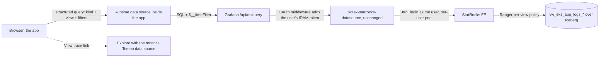

# kotak-starrocks-logs-app — Logs Drilldown (StarRocks)

A Grafana app plugin that gives the StarRocks log views (`vw_eks_app_logs_<app_id>`) the Loki Logs
Drilldown experience, without writing SQL. It does **not** change `kotak-starrocks-datasource`: every query
is plain SQL sent through that datasource, so the signed-in user's IDAM token is forwarded and StarRocks and
Ranger decide what each person sees, exactly as for dashboards.

| Logs Drilldown feature | Here |
|---|---|
| Header: label filters left; data source, time range and refresh right | Yes: "Filter by label values" combobox (labels, operators, a dropdown of values) on the left; **Data source** (one `kotak-starrocks-datasource` instance per StarRocks database) **+ View** (`SHOW TABLES LIKE 'vw_eks_app_logs_%'`, filtered by Ranger) + time (quick ranges up to 24 hours) + refresh on the right |
| Service grid: volume by level with totals + newest lines per service, "Search services" dropdown, page size and pages | Yes: one `GROUP BY` for all volumes, one `UNION ALL` for the visible page's lines |
| ★ Favourites, **Include / Remove**, Show logs on each service | Yes (favourites per browser, listed first) |
| "service" tab + **Add label** (closable tabs for other labels) | Yes |
| Logs tab: volume by level, lines, newest/oldest, wrap | Yes (Grafana's Logs panel) |
| **Infinite scroll**: the next lines load at the end of the list | Yes: pages of `lineLimit` lines with exact µs bounds, no gaps or repeats |
| Logs / Table / JSON views | Yes |
| Search in log lines: include / exclude, match case, regex | Yes |
| Label filters, "Log levels" select; filter buttons in log details | Yes |
| Trace links → Explore with the trace | Yes: per-tenant regex + Tempo uid |
| Show context | Yes: same pod, ±1 h (Grafana's context modal) |
| Labels tab, Fields tab (incl. key=value / JSON fields in lines) | Yes, with Include / Exclude |
| Patterns tab | Yes: **per-tenant configured patterns** (one scan), "(unmatched)" share, "Suggest patterns" from a sample |
| Open in Explore, share link (state in the URL), browser Back/Forward | Yes (Explore shows the SQL result as a table) |
| Level | Per tenant: the `level` column, or extracted from the message (observability) |

Not in this version: add-to-dashboard, alerts and an "Open in StarRocks drilldown" button inside Explore.

The app remembers, per browser, the last data source and view (opened by default next time) and the favourite
values per view and label.

## How it works



- `src/sql/builder.ts` builds all SQL. Identifiers are checked, values are escaped, and `$` is split out of
  literals so the datasource's macro engine cannot touch user text.
- `src/datasource/StarRocksLogsDataSource.ts` is the runtime data source every panel queries; it also
  implements "show context".
- `src/components/*` are the Scenes screens. All state is in the URL (label filters as `var-filters`, like
  Logs Drilldown; links from 0.1.0/0.2.0 with `filter=` still open).
- Long text scans are guarded (`maxScanHours`): the user sees a notice and can shorten the range or run anyway.

Screenshots from the end-to-end run (synthetic data): [header and service grid](docs/screenshots/00-layout.png),
[Include](docs/screenshots/02c-include.png), [Add label](docs/screenshots/02d-add-label.png),
[values dropdown](docs/screenshots/02e-values-dropdown.png), [quick ranges](docs/screenshots/00-quick-ranges.png),
[log details with trace link](docs/screenshots/03-log-details-trace-link.png),
[show context](docs/screenshots/05-show-context.png), [labels](docs/screenshots/06-labels-tab.png),
[patterns](docs/screenshots/08-patterns-tab.png).

**Architecture guide** (how every feature and query works, time handling, security, performance, decisions, Q&A, with diagrams readable on a phone): [docs/architecture/README.md](docs/architecture/README.md). More in [docs/DESIGN.md](docs/DESIGN.md). Rollout in [docs/ROLLOUT.md](docs/ROLLOUT.md). Building it from the
same repository and pipelines as the datasource: [docs/MONOREPO.md](docs/MONOREPO.md). Step-by-step rollout for
the Claude session on the org PC: [docs/ORG_AGENT_PROMPT.md](docs/ORG_AGENT_PROMPT.md) (0.1.0), then
[docs/ORG_AGENT_PROMPT_3_UPGRADE_0.3.0.md](docs/ORG_AGENT_PROMPT_3_UPGRADE_0.3.0.md) (0.1.0 → 0.3.0 in one patch:
data source picker and the Logs Drilldown look). Prompt 2 (0.2.0 only) is superseded by prompt 3.

## Configuration (app jsonData)

Provisioned per org from deploy-config (`provisioning/plugins/*.yaml`), or edited on the app's
configuration page. Invalid entries are ignored and listed on the page. The tenant is the view
(`vw_eks_app_logs_<app_id>`); generate the per-tenant trace settings from the existing Loki data sources with
`scripts/gen-tenants-from-loki.py` (see [docs/ROLLOUT.md](docs/ROLLOUT.md#how-tenants-are-defined)).

```yaml
apiVersion: 1
apps:
  - type: kotak-starrocks-logs-app
    org_id: 3
    jsonData:
      datasourceUid: app-logs-starrocks-db      # data source selected by default
      # datasources: [app-logs-starrocks-db, { uid: app-logs-starrocks-db2, viewPrefix: vw_eks_app_logs_ }]
      #   optional picker allowlist/order; default: every kotak-starrocks-datasource instance in the org
      viewPrefix: vw_eks_app_logs_
      defaultTimeRange: now-15m
      maxScanHours: 6                           # text scans over longer ranges ask first
      lineLimit: 1000                           # lines per page; scrolling to the end loads the next page
      # labels / fields: optional column lists (defaults: k8s_* and friends)
      tenants:                                  # keyed by app_id = view name without the prefix,
                                                # or <datasourceUid>/<app_id> for one database only
        default:
          level: { source: column }             # read the level column (normalised)
        app_1961_observability:
          level: { source: message }            # level column is empty: extract from the line
          trace: { regex: 'traceid=([0-9a-f]{32})', tempoUid: <tempo datasource uid> }
          patterns:
            - { name: Upstream timed out, like: '%upstream timed out%' }
            - { name: Connection refused, regex: 'Connection refused to [a-z0-9-]+:[0-9]+' }
```

- `level.regex` (message source, optional): RE2 regexes tried in order; the first capture group is the level.
  The defaults handle `level=info`, `"level":"info"`, bare `ERROR`/`WARN`/… and glog `E1118 …` prefixes.
- Several StarRocks databases: add one `kotak-starrocks-datasource` instance per database (each has its own
  `database` setting); they appear in the app's Data source picker. Views, columns and filters belong to the
  selected data source (URL key `ds`). Without an explicit choice the app opens `datasourceUid`, or the next
  data source where the user can see views.
- `patterns[].like` is a SQL LIKE pattern (`%` wildcard). Prefer `regex` when the text itself contains `%`,
  `_` or `\` (StarRocks 4.0 does not honour an escaped `\%` at the end of a LIKE pattern).

## Development

Node 22 and npm. No backend, no Go.

```bash
npm ci
npm run typecheck && npm run lint && npm run test:ci     # 58 unit tests
npm run build                                             # → dist/
./scripts/package.sh && ./scripts/verify-package.sh       # → package/kotak-starrocks-logs-app-<version>.zip
```

### End-to-end tests

`scripts/e2e.sh` runs Grafana 12.0.1-security-01 with this app and the **built, unchanged**
`kotak-starrocks-datasource` (`DATASOURCE_DIST`, default `../kotak-starrocks-datasource/dist`, the sibling folder in this repository), a mock IDAM,
and StarRocks 4.0.10 seeded with two databases (two data source instances), each with an `eks_app_logs`-shaped
table and tenant views, and native JWT users with per-view grants (standing in for Ranger).

```bash
npm run build
./scripts/e2e.sh up        # generates the app provisioning from dev/e2e/tenants/ (like deploy-config), seeds,
                           # Grafana http://localhost:23000 ("Sign in with IDAM", user e.g. kmbl3e2e)
./scripts/e2e.sh smoke     # 21 API checks: every query kind on StarRocks, per-user views, two databases, escaping,
                           # infinite-scroll pages join without gaps
./scripts/e2e.sh test      # 28 browser tests (Playwright, in mcr.microsoft.com/playwright:v1.52.0-noble;
                           # PLAYWRIGHT_LOCAL=1 runs them on the host if Chromium's libraries are installed)
./scripts/e2e.sh down
```

Test users: `kmbl3e2e` (db1: observability + cmm; db2: observability + payments), `kmbl3other` (db1: dpdpa),
`kmbl3db2only` (db2: payments), `kmbl3none` (no views), `kmbl3admin` (Grafana admin, db1: observability).
