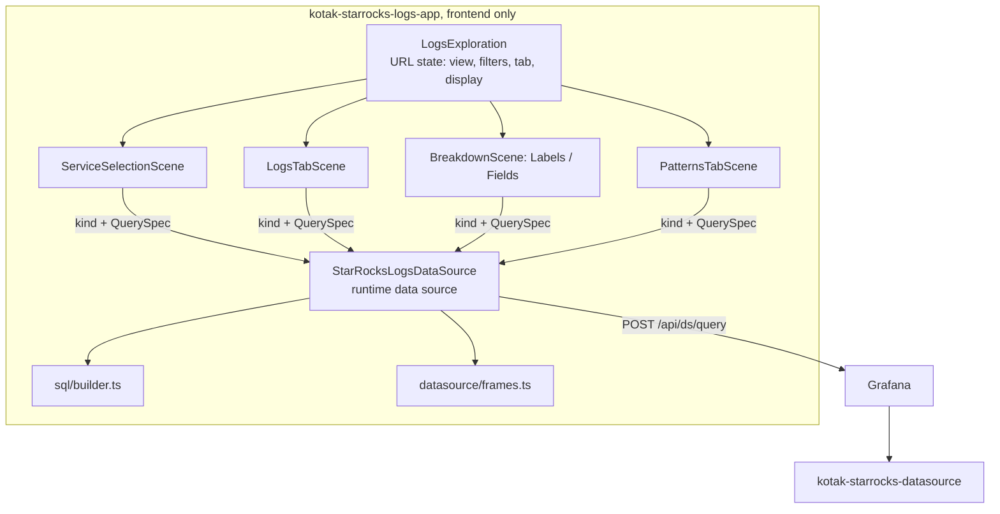

# Design

## Constraints that shaped it

- **`kotak-starrocks-datasource` stays unchanged.** It is the production plugin for the StarRocks FE.
- **Per-user identity must hold.** Grafana forwards the user's OAuth token only to data source plugins
  (`OAuthTokenMiddleware.applyToken` skips requests without `DataSourceInstanceSettings`), so an app backend
  could not log in to StarRocks as the user. The app therefore has **no backend**: it sends SQL to
  `/api/ds/query` addressed to the datasource, and the datasource does the JWT login.
- **Ranger blocks `information_schema`, `DESCRIBE` and `SHOW COLUMNS`.** Views come from
  `SHOW TABLES LIKE 'vw_eks_app_logs_%'`, columns from `SELECT * FROM <view> LIMIT 0`.
- **Same schema for every view** (21 columns over one Iceberg table `eks_app_logs`, partitioned by
  `app_id, hour(observed_timestamp)`), so the column roles are fixed in code; missing columns are dropped.
- **Grafana 12.0.1**: `@grafana/*` 12.0.1 and `@grafana/scenes` 6.20.2 (the last 6.x without the
  `@grafana/i18n` peer, which 12.0 does not provide). `react-router-dom` v6 is bundled; `react-router` is
  shared by Grafana.
- **Small cluster** (UAT: one CN, 6 CPU) and no query queue: few queries per screen, text scans guarded.

## Structure

A `QuerySpec` is the view plus every filter (label filters, levels, line filters, pattern filters,
message-field filters). Panels send `{kind, spec, params}` to the runtime data source, which builds the SQL,
runs it, and turns the rows into frames (log lines, per-level series, per-value series).

## Data sources and databases

Each `kotak-starrocks-datasource` instance is scoped to one StarRocks database (its `database` setting, which
is also the database StarRocks checks at login). The app therefore has a **Data source picker** next to the
view picker:

- The list is `datasources` from the settings (allowlist and order), or every instance of the plugin type
  the user can see in the org. In OSS Grafana every org user sees every data source; the picker is not an
  access control, Ranger still is.
- Every query carries the selected data source uid (`QuerySpec.datasource`); views, columns and filters
  belong to it, so switching resets them. The choice is in the URL (`ds`).
- Without a choice in the URL, the app tries `datasourceUid` first and falls back to the next data source
  where `SHOW TABLES` returns views for the user; failures are shown next to the data source in the picker.
- Tenant settings can be scoped to one database: `tenants["<datasourceUid>/<app_id>"]` wins field by field
  over `tenants["<app_id>"]`, then `default`. A data source can have its own `viewPrefix`.

## SQL per feature

All queries start with `WHERE $__timeFilter(observed_timestamp)` (expanded by the datasource; it lets
StarRocks prune hourly partitions; verified on UAT: 2/2521 partitions for 1 h).

| Feature | Query |
|---|---|
| Views | `SHOW TABLES LIKE 'vw_eks_app_logs_%'` |
| Columns | `SELECT * FROM <view> LIMIT 0` |
| Service grid volumes | `SELECT bucket t, <label> v, <level> lvl, COUNT(*) … GROUP BY t, v, lvl` (all services) |
| Service grid lines | `(SELECT … WHERE <label>='a' ORDER BY ts DESC LIMIT 10) UNION ALL (…)` for the page |
| Logs | `SELECT ts, CAST(ts AS VARCHAR) __ts, message, <level> detected_level, <columns> … AND ts >= <from µs> AND ts < <to + 1 ms µs> ORDER BY ts DESC LIMIT n` |
| Values of a label (filter combobox) | `SELECT <col> v, COUNT(*) c … GROUP BY v ORDER BY c DESC LIMIT 200`, under the other label filters |
| Log volume | `SELECT bucket t, <level> g, COUNT(*) … GROUP BY t, g` |
| Labels / Fields overview | one scan: `GROUP BY GROUPING SETS ((t, a), (t, b), …)` with `GROUPING_ID` |
| Value breakdown | `SELECT bucket t, <col> v, COUNT(*) … GROUP BY t, v` (top 30 shown) |
| Message field breakdown | `regexp_extract(message, '<key>=(value)', 2)` grouped per bucket |
| Patterns | `CASE WHEN <p1> THEN 'p1' WHEN … ELSE '' END` grouped per bucket: all patterns, one scan |
| Show context | same `k8s_pod_uid`, `ts < / > <exact µs ts>`, within 1 h, `LIMIT n` |

Level: `CASE lower(trim(level)) WHEN 'error' … ELSE 'unknown' END` (same buckets as the StarRocks
Application Logs dashboard plus glog letters), or for message tenants
`lower(coalesce(nullif(regexp_extract(message, r1, 1), ''), …))` into the same CASE.

Line search: case-insensitive `lower(message) LIKE '%text%'` by default; `instr()` when the text contains
`%`, `_` or `\` (StarRocks 4.0 does not match an escaped `\%` at the end of a LIKE pattern, found in the
local tests); `regexp(message, '(?i)…')` for regex searches.

## Screens and state

- **Header** (like Logs Drilldown): left, the "Filter by label values" combobox, a Scenes `AdHocFiltersVariable`
  (`layout: combobox`) whose keys are the view's label and field columns and whose values come from the query
  above; right, Data source, View, time range (quick ranges 5 minutes to 24 hours) and refresh. Below about
  1350 px of content the right group wraps under the filters.
- **Service grid** ("selection" page): one tab per label (the service label, shown as "service", plus tabs
  added with "Add label"); each value has its volume by level (legend table with totals), its newest lines,
  ★, Include / Remove (a `=` filter on that label; several values of one label become `IN (…)`) and
  Show logs. The grid ignores filters on its own label, so Include does not re-run it.
- **Logs page** ("details"): "Log levels" select, line search, then the Logs / Labels / Fields / Patterns tabs.
- **URL**: `ds`, `view`, `page`, `label`, `tabs`, `var-filters` (Scenes format), `level`, `line`, `pattern`,
  `field`, `tab`, `breakdown`, `sort`, `limit`, `display`, `wrap`, `search`, `from`, `to`. Page, tab, view and
  data source changes add browser history steps. `filter=` (0.1.0/0.2.0) is read and converted.
- **Choosing a view**: the URL's view if the user can read it, else the last view used in this browser (same
  data source), else the first. An empty or missing `view` in a URL update never clears the selection, and the
  body re-selects a view if it ever finds none while views exist. Last selection and favourites are kept in
  `localStorage` (per browser; failures are ignored).

## Infinite scroll

Grafana's Logs panel (`enableInfiniteScrolling`) asks the data source for more lines when the user scrolls to
the end: for newest-first it re-runs the same query with the range `[from, time of the oldest line shown]` and
merges the result, dropping lines whose time and `id` it already has. Two details make the pages join exactly:

1. **Exact bounds.** `$__timeFilter` is truncated to whole seconds, which would repeat or skip lines inside a
   second. The logs query therefore also has `ts >= microseconds_add(FROM_UNIXTIME(s), µs)` and
   `ts < <to + 1 ms>` (the panel's times are milliseconds; the line at the boundary millisecond is fetched
   again and removed by id). The macro range is widened to whole seconds around those bounds, so partition
   pruning still applies.
2. **Stable ids.** A line's id is `<µs timestamp>_<pod uid or name>_<FNV-1a of the message>` (with `#n` for
   identical lines in the same microsecond), the same in every query, so the overlap is recognised.

The smoke test `infinite scroll` checks on StarRocks that two pages equal one larger query (no gaps, overlap
only at the boundary millisecond); the browser test scrolls past 1000 lines.

## Safety

- Identifiers must match `^[A-Za-z_][A-Za-z0-9_]*$` and be columns of the view; everything else is a
  quoted literal (`\` and `'` escaped). Tested with injection strings against StarRocks.
- The datasource expands `$name(...)` and `$__interval` anywhere in the SQL, including literals. Literals
  containing `$` are emitted as `concat('…', '$', '…')`, so user text is never expanded.
- Users can already run any SQL as themselves in Explore; Ranger is the authorisation boundary. The app adds
  no new access path.

## Cost guardrails

| Situation | Behaviour |
|---|---|
| Range ≤ `maxScanHours` | everything runs |
| Range > `maxScanHours`, level read from the message, no text filters | volumes run **without** the level split (cheap), with a notice and "split anyway" |
| Range > `maxScanHours` and a line / field / pattern / message-level filter, or the Patterns tab | a notice with "Use the last N hours" and "Run anyway" (remembered for that range) |

Queries per screen: service grid 2, Logs tab 2 (+1 per infinite-scroll page), Labels/Fields 1 (+1 sample for
message fields), Patterns 1, values dropdown 1 when opened. Superseded requests are cancelled by Scenes. The
time picker offers quick ranges up to 24 hours (longer ranges can still be typed; the guardrails above apply).

## Known limitations

- Infinite scroll works in the Logs display; Table and JSON show the first `lineLimit` lines.
- Favourites and the last view are per browser (`localStorage`), not per Grafana user.

- "Open in Explore" opens the SQL in Explore; Explore shows a table because the datasource returns table
  frames (a logs view there would need a datasource change).
- A user whose login fails at the datasource's default-database check gets "invalid connection" from
  datasource 0.1.0; the app explains it but cannot show the underlying 5203/5204.
- Patterns are only as good as the configured list; the "(unmatched)" share shows the gap and "Suggest
  patterns" proposes entries from a sample (sample counts, not full-range counts).
- Trace links need a per-tenant regex; tenants whose trace ids are not in the message get none.
