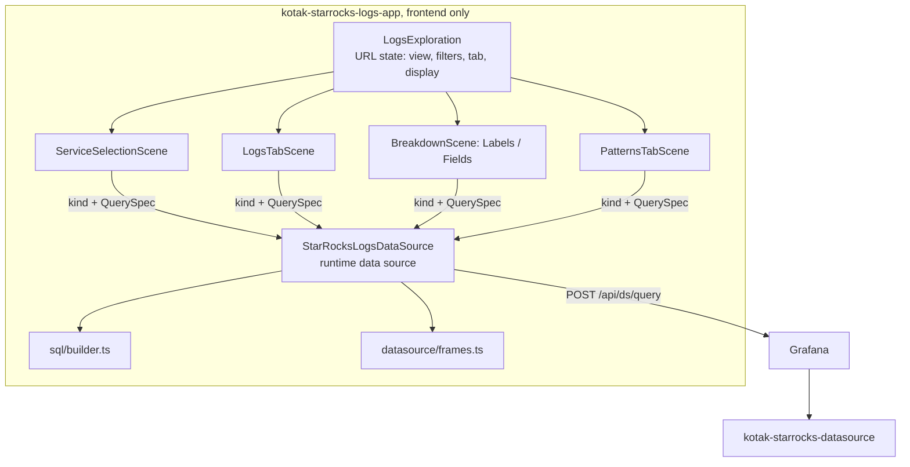

# Design

## Constraints that shaped it

- **`kotak-starrocks-datasource` stays unchanged.** It is the production plugin for the StarRocks FE.
- **Per-user identity must hold.** Grafana forwards the user's OAuth token only to data source plugins
  (`OAuthTokenMiddleware.applyToken` skips requests without `DataSourceInstanceSettings`), so an app backend
  could not log in to StarRocks as the user. The app therefore has **no backend**: it sends SQL to
  `/api/ds/query` addressed to the datasource, and the datasource does the JWT login.
- **Ranger blocks `information_schema`, `DESCRIBE` and `SHOW COLUMNS`.** Views come from
  `SHOW TABLES LIKE 'vw_eks_app_logs_%'`, columns from `SELECT * FROM <view> LIMIT 0`.
- **Same schema for every view** (21 columns over one Iceberg table `eks_app_logs`, partitioned by
  `app_id, hour(observed_timestamp)`), so the column roles are fixed in code; missing columns are dropped.
- **Grafana 12.0.1**: `@grafana/*` 12.0.1 and `@grafana/scenes` 6.20.2 (the last 6.x without the
  `@grafana/i18n` peer, which 12.0 does not provide). `react-router-dom` v6 is bundled; `react-router` is
  shared by Grafana.
- **Small cluster** (UAT: one CN, 6 CPU) and no query queue: few queries per screen, text scans guarded.

## Structure

A `QuerySpec` is the view plus every filter (label filters, levels, line filters, pattern filters,
message-field filters). Panels send `{kind, spec, params}` to the runtime data source, which builds the SQL,
runs it, and turns the rows into frames (log lines, per-level series, per-value series).

## SQL per feature

All queries start with `WHERE $__timeFilter(observed_timestamp)` (expanded by the datasource; it lets
StarRocks prune hourly partitions; verified on UAT: 2/2521 partitions for 1 h).

| Feature | Query |
|---|---|
| Views | `SHOW TABLES LIKE 'vw_eks_app_logs_%'` |
| Columns | `SELECT * FROM <view> LIMIT 0` |
| Service grid volumes | `SELECT bucket t, <label> v, <level> lvl, COUNT(*) … GROUP BY t, v, lvl` (all services) |
| Service grid lines | `(SELECT … WHERE <label>='a' ORDER BY ts DESC LIMIT 10) UNION ALL (…)` for the page |
| Logs | `SELECT ts, CAST(ts AS VARCHAR) __ts, message, <level> detected_level, <columns> … ORDER BY ts DESC LIMIT n` |
| Log volume | `SELECT bucket t, <level> g, COUNT(*) … GROUP BY t, g` |
| Labels / Fields overview | one scan: `GROUP BY GROUPING SETS ((t, a), (t, b), …)` with `GROUPING_ID` |
| Value breakdown | `SELECT bucket t, <col> v, COUNT(*) … GROUP BY t, v` (top 30 shown) |
| Message field breakdown | `regexp_extract(message, '<key>=(value)', 2)` grouped per bucket |
| Patterns | `CASE WHEN <p1> THEN 'p1' WHEN … ELSE '' END` grouped per bucket: all patterns, one scan |
| Show context | same `k8s_pod_uid`, `ts < / > <exact µs ts>`, within 1 h, `LIMIT n` |

Level: `CASE lower(trim(level)) WHEN 'error' … ELSE 'unknown' END` (same buckets as the StarRocks
Application Logs dashboard plus glog letters), or for message tenants
`lower(coalesce(nullif(regexp_extract(message, r1, 1), ''), …))` into the same CASE.

Line search: case-insensitive `lower(message) LIKE '%text%'` by default; `instr()` when the text contains
`%`, `_` or `\` (StarRocks 4.0 does not match an escaped `\%` at the end of a LIKE pattern, found in the
local tests); `regexp(message, '(?i)…')` for regex searches.

## Safety

- Identifiers must match `^[A-Za-z_][A-Za-z0-9_]*$` and be columns of the view; everything else is a
  quoted literal (`\` and `'` escaped). Tested with injection strings against StarRocks.
- The datasource expands `$name(...)` and `$__interval` anywhere in the SQL, including literals. Literals
  containing `$` are emitted as `concat('…', '$', '…')`, so user text is never expanded.
- Users can already run any SQL as themselves in Explore; Ranger is the authorisation boundary. The app adds
  no new access path.

## Cost guardrails

| Situation | Behaviour |
|---|---|
| Range ≤ `maxScanHours` | everything runs |
| Range > `maxScanHours`, level read from the message, no text filters | volumes run **without** the level split (cheap), with a notice and "split anyway" |
| Range > `maxScanHours` and a line / field / pattern / message-level filter, or the Patterns tab | a notice with "Use the last N hours" and "Run anyway" (remembered for that range) |

Queries per screen: service grid 2, Logs tab 2, Labels/Fields 1 (+1 sample for message fields),
Patterns 1. Superseded requests are cancelled by Scenes.

## Known limitations

- "Open in Explore" opens the SQL in Explore; Explore shows a table because the datasource returns table
  frames (a logs view there would need a datasource change).
- A user whose login fails at the datasource's default-database check gets "invalid connection" from
  datasource 0.1.0; the app explains it but cannot show the underlying 5203/5204.
- Patterns are only as good as the configured list; the "(unmatched)" share shows the gap and "Suggest
  patterns" proposes entries from a sample (sample counts, not full-range counts).
- Trace links need a per-tenant regex; tenants whose trace ids are not in the message get none.
