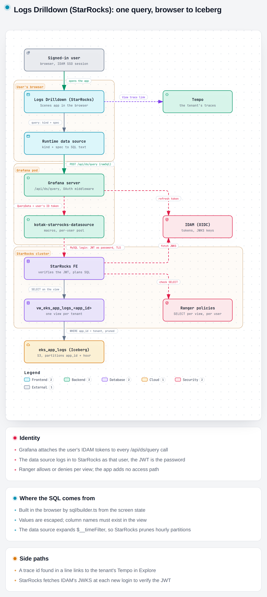
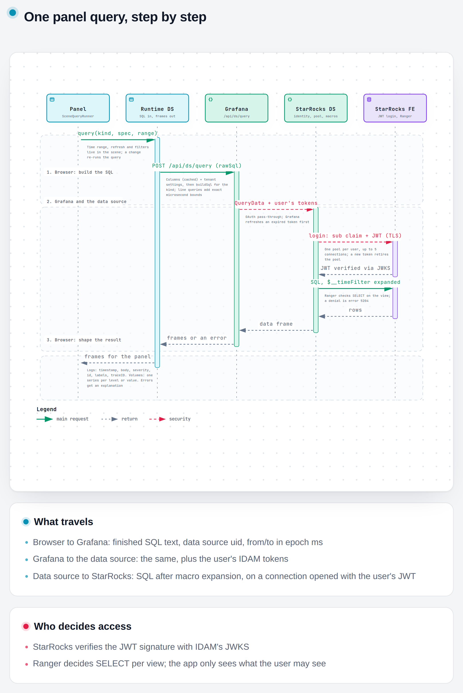

# 1. Big picture

[Index](README.md) · Next: [Going live](02-going-live.md)

## What it is

**Logs Drilldown (StarRocks)** (plugin id `kotak-starrocks-logs-app`) gives the StarRocks log views the
experience of Grafana's Loki **Logs Drilldown**, without writing SQL:

- a service grid with log volume per service, and per level;
- label filters, log levels and line search;
- the log lines in Grafana's Logs panel, with log details, Show context and trace links;
- Labels, Fields and Patterns tabs.

It is a **Grafana app plugin** written in TypeScript with Grafana Scenes. It has **no backend binary**.

## Why it exists, and the rules it follows

- Application logs are moving from Loki to StarRocks: one Iceberg table `eks_app_logs`, read through one
  view per tenant, `vw_eks_app_logs_<app_id>`.
- Users must only see the views their Ranger policies allow. That already works for dashboards through
  `kotak-starrocks-datasource`, which logs in to StarRocks **as the signed-in user**.
- `kotak-starrocks-datasource` is the production plugin and **must not change**.

So the app reuses the data source exactly as dashboards do: it only sends it SQL.

## The parts

| Part | Where it runs | Job |
|---|---|---|
| The app (Scenes UI) | user's browser | screens, state in the URL, decides what to ask |
| Runtime data source | user's browser, inside the app | turns `{kind, spec}` into SQL; turns rows into Grafana frames |
| Grafana server | Grafana pod | `/api/ds/query`; attaches the user's IDAM tokens |
| `kotak-starrocks-datasource` | Grafana pod (Go plugin) | expands macros; logs in to StarRocks as the user; runs SQL |
| StarRocks FE | StarRocks cluster | verifies the JWT with IDAM's keys; plans and runs SQL |
| Ranger | StarRocks cluster | allows or denies SELECT per view, per user |
| Views and Iceberg table | StarRocks, S3 | `vw_eks_app_logs_<app_id>` over `eks_app_logs` |
| IDAM | identity provider | issues and refreshes tokens; publishes the JWKS keys |
| Tempo | per tenant | opens a trace when a line has a trace id |

## One query, step by step

1. A panel on screen (say the log volume) belongs to a **SceneQueryRunner**. The runner holds a structured
   query: `{kind: 'volume', spec: {datasource, view, filters…}}`.
2. The runner calls the app's **runtime data source** with that query and the current time range.
3. The runtime data source loads the view's column list (cached) and the tenant's settings. It then builds
   the SQL for that kind with `sql/builder.ts`.
4. It POSTs the SQL to **`/api/ds/query`**, addressed to the selected `kotak-starrocks-datasource`
   instance by its uid, with `from` and `to` in epoch milliseconds.
5. Grafana's **OAuth pass-through** attaches the user's IDAM tokens to the call to the data source plugin.
   It first refreshes them if they have expired.
6. The data source reads the username from the token's `sub` claim. It takes a connection from that
   user's pool, or opens one with **username = sub, password = the JWT, over TLS**.
7. **StarRocks** verifies the JWT signature with IDAM's JWKS when a connection is opened.
8. The data source expands **`$__timeFilter(observed_timestamp)`** into
   `observed_timestamp BETWEEN FROM_UNIXTIME(<from s>) AND FROM_UNIXTIME(<to s>)` and runs the SQL.
9. **Ranger** checks SELECT on the view. A denial comes back as error **5204**.
10. Rows return as a data frame, then as JSON to the browser.
11. The runtime data source shapes the rows for the panel: a logs frame, or one time series per level or
    value. The panel draws.

## Identity in one paragraph

The user signs in to Grafana with IDAM. Grafana stores the tokens (encrypted) and attaches them to every
data source request when the data source has OAuth pass-through on. `kotak-starrocks-datasource` uses the
**ID token** by default (configurable). The StarRocks username comes from the **`sub`** claim (also
configurable), and the token itself is the password. StarRocks checks the signature against IDAM's JWKS,
then Ranger applies that user's policies. Each user has their own small connection pool: up to 5
connections, closed after 60 s idle, and retired when the token changes or expires. A connection is never
shared between users.

## What the app does not do

- It does not store, see or forward tokens. Grafana and the data source handle them.
- It does not decide access. A view missing from `SHOW TABLES` for the user never appears; a query on a view
  the user cannot read fails with 5204.
- It does not change the data source plugin, Ranger, StarRocks or Grafana.
- It does not write anything to StarRocks. Every statement is SELECT or SHOW.

## Words you will see

- **View**: a `vw_eks_app_logs_<app_id>` view, one per tenant.
- **Tenant settings**: display settings per `app_id` (level source, trace regex and Tempo uid, patterns).
- **Spec** (`QuerySpec`): the data source, the view, and every filter currently applied.
- **Kind**: which query a panel wants (`serviceVolume`, `logs`, `volume`, `patterns`…).

More in the [glossary](14-glossary.md).
