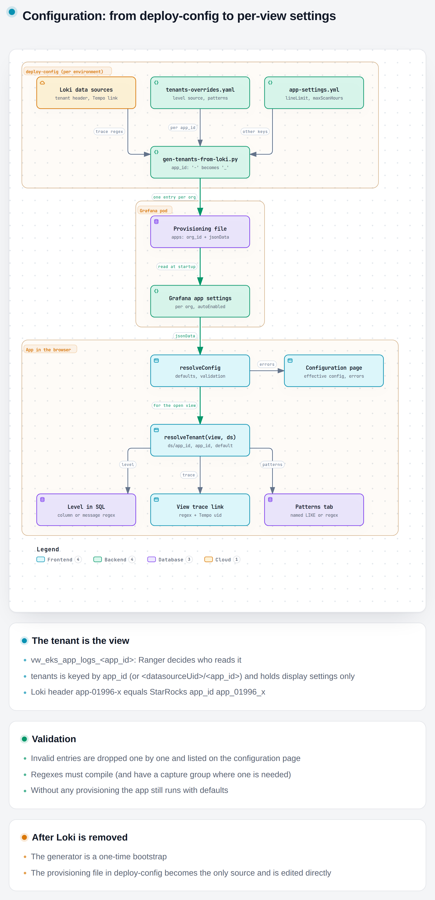

# 2. Going live: packaging, loading, configuration

[Index](README.md) · Previous: [Big picture](01-big-picture.md) · Next: [Code and scenes](03-code-and-scenes.md)

## The artifact

`scripts/build-plugin.sh plugins/kotak-starrocks-logs-app` (or the pipeline) runs:

1. `npm ci`, typecheck, lint, 58 unit tests;
2. webpack production build into `dist/`: `module.js`, `plugin.json`, `img/logo.svg`, README, CHANGELOG;
3. `scripts/package.sh`, which zips to `package/kotak-starrocks-logs-app-<version>.zip`;
4. `scripts/verify-package.sh`, which checks the id, the version and the layout.

There is no Go binary, so no `chmod` and no per-architecture build.

## How it is installed

- **Zip to feed to S3.** The pipeline publishes the zip, and deploy-config's `grafana-plugin-upload.yml`
  puts it in the plugins bucket, the same way as the data source.
- **Pod start.** The `s3-sync-init` container copies it into `/grafana/plugins` (the pod filesystem is
  rebuilt on every restart).
- **`grafana.ini`**:
  - `allow_loading_unsigned_plugins` lists `kotak-starrocks-logs-app` (the plugin is not signed);
  - `[navigation.app_sections] kotak-starrocks-logs-app = drilldown 5` puts it as a card on the
    **Drilldown** page and in the Drilldown menu.

## What Grafana does with it

1. **Reads `plugin.json`** at startup:
   - `type: app`, `id: kotak-starrocks-logs-app`, name "Logs Drilldown (StarRocks)";
   - `"autoEnabled": true`, so the app is enabled in **every org** with no admin action;
   - one page, "Logs Drilldown (StarRocks)", at `/a/kotak-starrocks-logs-app/explore`, Viewer role;
   - `grafanaDependency >= 12.0.0`, and a dependency on the `kotak-starrocks-datasource` plugin.
2. **Reads the provisioning file** (`/etc/grafana/provisioning/plugins/*.yaml`, mounted from a
   ConfigMap). Each `apps:` entry sets the app's `jsonData` for one org.
3. **When a user opens the page**, Grafana loads `module.js` and renders the app's root component with
   `props.meta.jsonData` (that org's settings).

## What the app does when it starts (`App.tsx`)

1. `setAppConfig(props.meta.jsonData)` validates and resolves the settings (below). This runs on every
   render, so new settings apply on the next page load.
2. `ensureRuntimeDataSource(...)` creates the **runtime data source**
   (`type = uid = kotak-starrocks-logs-runtime`) once per page load and registers it in **two registries**:
   - the **Scenes registry**, so SceneQueryRunners can query it;
   - **Grafana core's registry** (`getDataSourceSrv().registerRuntimeDataSource`), because the core
     **Logs panel** looks data sources up there. Without it, Show context and infinite scroll would not work.
3. A **SceneApp** with two routes:
   - `explore/*`: the drilldown page, an `EmbeddedScene` with a `SceneTimeRange` starting at
     `defaultTimeRange` and a `LogsExploration` body;
   - `*`: anything else under `/a/kotak-starrocks-logs-app/` redirects to `/explore`.
   - URL sync is on, with `createBrowserHistorySteps`, so browser Back/Forward work.

## Configuration flow



### Settings keys (`jsonData`)

| Key | Default | Meaning |
|---|---|---|
| `datasourceUid` | `app-logs-starrocks-db` | data source chosen by default |
| `datasourceType` | `kotak-starrocks-datasource` | plugin type of all data sources used |
| `datasources` | (all instances) | picker allowlist and order: `[uid]` or `[{uid, viewPrefix}]` |
| `viewPrefix` | `vw_eks_app_logs_` | view name prefix; app_id = the rest |
| `serviceLabel` | `k8s_service_name` | column of the first grid tab, shown as "service" |
| `defaultTimeRange` | `now-15m` | must look like `now-<n><s,m,h,d,w>` |
| `maxScanHours` | `6` | longer text scans ask first (0 < n ≤ 2160) |
| `lineLimit` | `1000` | lines per page (10 to 5000) |
| `labels` | 12 k8s/app columns | label-like columns (tabs, filters, Labels tab) |
| `fields` | pod name/uid, start time, log path | field-like columns (Fields tab, filters) |
| `tenants` | `{}` | per-tenant display settings, see below |

### Validation (`config/config.ts`, `resolveConfig`)

- Each key is checked on its own. An **invalid entry is dropped and reported**, and everything else keeps
  working. One typo in one tenant does not break the app for everyone.
- Column names must match `^[A-Za-z_][A-Za-z0-9_]*$`. Prefixes allow only letters, digits and `_`.
- Regexes are compiled to check them. A level or trace regex must have a **capture group**.
- A pattern needs a name and **exactly one** of `like` / `regex`. Names must be unique per tenant.
- `serviceLabel` is added to `labels` if it is missing.
- The problems are shown on top of the app page and on the configuration page.

### Tenant settings and how a view finds them

The **tenant is the view**: for `vw_eks_app_logs_app_01996_frontlineplatforms_cmm` the key is
`app_01996_frontlineplatforms_cmm` (the view name without the data source's `viewPrefix`).

```yaml
tenants:
  default:                       # applies to every tenant
    level: { source: column }
  app_1961_observability:
    level: { source: message }   # level column empty: read from the line
    trace: { regex: 'traceid=([0-9a-f]{32})', tempoUid: <tempo uid> }
    patterns:
      - { name: Upstream timed out, like: '%upstream timed out%' }
  e2e-ds-starrocks-logs2/app_1961_observability:   # one database only
    level: { source: column }
```

`resolveTenant(view, datasourceUid)` picks **each field separately**. It takes the first that has it of:

1. `tenants["<datasourceUid>/<app_id>"]`
2. `tenants["<app_id>"]`
3. `tenants.default`
4. built-in: level from the column, no trace link, no patterns

For `level.source: message` without `regex`, three built-in regexes are tried in order: `level=…`
(logfmt/JSON), a bare `ERROR`/`WARN`/… word, and a glog `E1118 ` prefix.

**These settings are not access control.** They apply only when someone who can already read the view
opens it.

### Where the tenant settings come from

`scripts/gen-tenants-from-loki.py` generates the provisioning file from deploy-config's Loki data sources,
so trace patterns are written once:

- A Loki data source's `X-Scope-OrgID` header is the tenant: `app-01996-frontlineplatforms-cmm` becomes
  app_id `app_01996_frontlineplatforms_cmm` (`-` replaced by `_`).
- Its first derived field that links to a data source becomes `trace: {regex, tempoUid, linkTitle}`.
- `--overrides` adds what Loki does not have: level source, patterns, trace regexes for tenants without a
  derived field. Its `default` entry becomes `tenants.default`.
- `--settings` adds the other keys. `--pin-datasources` writes the org's StarRocks data sources as
  `datasources`.
- One `apps:` entry is written per org that has a `kotak-starrocks-datasource`.

After Loki is removed, the generator is no longer needed. The generated file in deploy-config becomes the
only source, and is edited directly.

### Without provisioning

The app still works with the defaults (it is `autoEnabled`): levels from the column, no trace links, no
patterns. A Grafana admin can paste JSON on **Administration → Plugins → Logs Drilldown (StarRocks) →
Configuration**. That page offers:

- a JSON editor, with the validation result shown live;
- **Save** (`POST /api/plugins/kotak-starrocks-logs-app/settings`); the next provisioning run replaces it;
- **Test: list my views**, which runs `SHOW TABLES` on every listed data source as the admin;
- the **effective configuration** after defaults and validation.

## Several StarRocks databases

Each `kotak-starrocks-datasource` instance is scoped to **one database**: its `database` setting, which is
also the database StarRocks checks at login. To add a database:

1. StarRocks and Ranger: the database has its `vw_eks_app_logs_*` views and per-view policies.
2. deploy-config: add another `kotak-starrocks-datasource` entry, with a new `name`, `uid` and
   `jsonData.database`.
3. It appears in the app's **Data source** picker automatically. To fix the list and order, use
   `datasources` or `--pin-datasources`.

## Upgrading

Upload the new zip, change the version in `s3-sync-init`, and restart the pod. Settings keys are backward
compatible from 0.1.0 to 0.3.0. 0.1.0 links (with `filter=`) still open.
