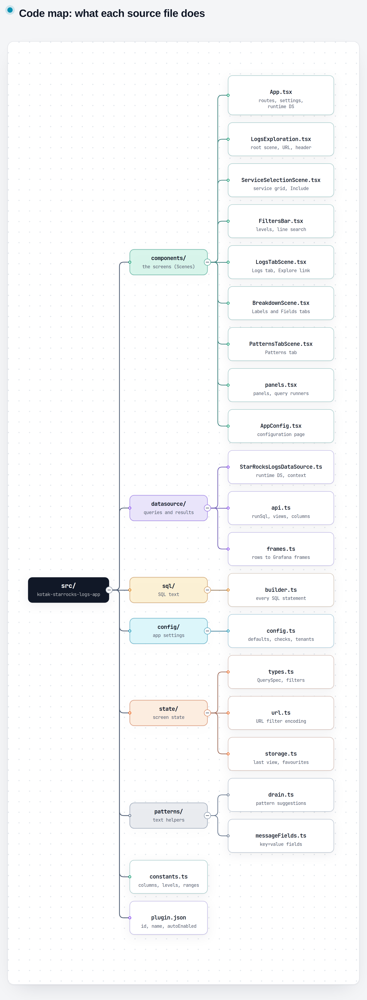
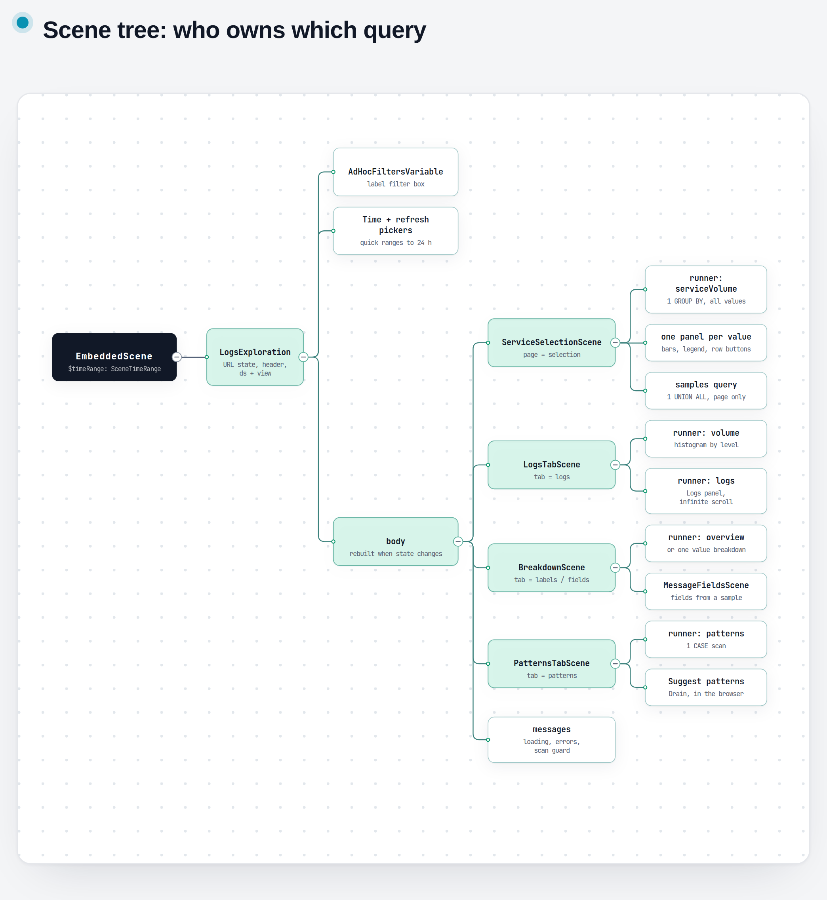

# 3. Code and scenes: how it is put together

[Index](README.md) · Previous: [Going live](02-going-live.md) · Next: [Opening and navigating](04-opening-and-navigating.md)

## Code map



Three layers, each with one job:

| Layer | Files | Job |
|---|---|---|
| Screens | `components/*` | what is on screen, user actions, state in the URL |
| Query engine | `datasource/*`, `sql/builder.ts` | structured query to SQL, SQL to Grafana, rows to frames |
| Settings and helpers | `config/config.ts`, `state/*`, `patterns/*`, `constants.ts` | settings, state types, text helpers |

Two small files are not in the diagram: `components/api.ts`, the interface between screens, and
`components/ui.tsx` (chips, the sample line list, the scan guard notice).

## Scenes in two minutes

[Grafana Scenes](https://grafana.com/developers/scenes) (here 6.20.2) is the library Grafana's own
drilldown apps use. A screen is a **tree of scene objects**. Each object has state, a React renderer, and
optionally:

- a **`$data`** provider, usually a `SceneQueryRunner` that runs queries against a data source;
- a **`$timeRange`**, inherited by everything below it;
- **URL sync**: the object declares URL keys, writes its state to them and reads them back.

A `SceneQueryRunner` re-runs by itself when the time range changes, when the refresh button is pressed, or
when the auto-refresh interval fires. It cancels superseded requests.

## The scene tree



- **`EmbeddedScene`** owns the `SceneTimeRange` (the time picker's value).
- **`LogsExploration`** (`components/LogsExploration.tsx`) is the root of the drilldown. It:
  - owns the URL state (see below);
  - renders the header: label filters, Show logs, Data source, View, time picker, refresh;
  - loads the data sources, views and columns;
  - **builds the body**: one object, rebuilt when the page, tab, view or filters change.
- **The body** is one of:
  - `ServiceSelectionScene`: the service grid (page `selection`);
  - `LogsTabScene`, `BreakdownScene` (Labels and Fields) or `PatternsTabScene`: the logs page (page
    `details`), one per tab;
  - a message: loading, an error, the scan guard.

Child scenes reach the root through `getExploration(this)`, which walks up the parents to the object that
implements `ExplorationApi` (`components/api.ts`). Through it they read the spec, the view context and the
display options, and they add filters, select values or change tabs.

## The structured query

Panels never hold SQL. They hold a **`LogsAppQuery`**:

```ts
{ refId, kind, spec, params }
```

**`spec` (`QuerySpec`)**: everything that narrows the rows, apart from the time range.

```ts
{
  datasource: 'app-logs-starrocks-db',  // which StarRocks database
  view: 'vw_eks_app_logs_app_1961_observability',
  filters:        [{ key, op: '='|'!='|'=~'|'!~', value }],  // label filters
  levels:         ['error', 'warn'],                           // [] = all
  lineFilters:    [{ op: 'include'|'exclude', value, caseSensitive, regex }],
  patternFilters: [{ name, op: 'include'|'exclude' }],
  fieldFilters:   [{ key, op: '='|'!=', value }],              // key=value inside the line
}
```

**`kind`**: which query. **`params`**: per-kind options.

| Kind | Used by | params |
|---|---|---|
| `serviceVolume` | service grid volumes | `label`, `withLevel` |
| `serviceSamples` | newest lines per grid row | `label`, `values`, `perValue` |
| `volume` | Logs tab histogram | `withLevel` |
| `logs` | Logs panel, JSON, samples for fields and suggestions | `limit`, `sort` |
| `table` | Table view, Open in Explore | `limit`, `sort` |
| `labelOverview` | Labels and Fields overview | `labels`, `topN` |
| `valueBreakdown` | one column's values | `label`, `topN` |
| `fieldBreakdown` | one key=value field's values | `field`, `topN` |
| `patterns` | Patterns tab | — |

The runtime data source (`datasource/StarRocksLogsDataSource.ts`) does three things for each query:

1. `buildContext`: the view's columns (`SELECT * … LIMIT 0`, cached) and its resolved tenant settings;
2. `buildSql`: the SQL for the kind ([Queries](05-queries.md));
3. `runSql`, then `transform`: rows to frames (`datasource/frames.ts`).

Every query is also tagged with `datasource: kotak-starrocks-logs-runtime`, so the Logs panel can find the
data source per query for Show context.

## State: what lives where

### In the URL (shareable, survives reload, Back/Forward)

| Key | Meaning | Example |
|---|---|---|
| `ds` | data source uid | `ds=app-logs-starrocks-db` |
| `view` | view | `view=vw_eks_app_logs_app_1961_observability` |
| `page` | `details` = logs page; absent = grid | `page=details` |
| `label` | active grid tab when not the service | `label=k8s_namespace_name` |
| `tabs` | label tabs added with Add label | `tabs=k8s_namespace_name` |
| `var-filters` | label filters (Scenes format) | `var-filters=k8s_service_name\|=\|proxy` |
| `level` | log levels, repeated | `level=error&level=warn` |
| `line` | line filters `op\|case\|regex\|text` | `line=include\|0\|0\|timeout` |
| `pattern` | pattern filters `op\|name` | `pattern=include\|Upstream%20timed%20out` |
| `field` | message field filters `key\|op\|value` | `field=status\|%3D\|500` |
| `tab` | `labels`, `fields`, `patterns` (absent = logs) | `tab=patterns` |
| `breakdown` | selected column, or `msg:<key>` | `breakdown=msg:status` |
| `sort` | `asc` (absent = newest first) | `sort=asc` |
| `limit` | line limit if not the default | `limit=2000` |
| `display` | `table` or `json` (absent = logs) | `display=json` |
| `wrap` | `1` = wrap lines | `wrap=1` |
| `search` | grid search text | `search=otel` |
| `from`, `to` | time range (Scenes) | `from=now-1h&to=now` |
| `filter` | 0.1.0/0.2.0 label filters, read once and converted | `filter=k8s_service_name\|%3D\|proxy` |

Rules:

- **A URL without `ds` or `view`, or with an empty value, never clears them.** They are picked
  automatically, and a URL update can race with that pick (see [Opening](04-opening-and-navigating.md)).
- **Navigation adds a browser history step**: page, tab, view, data source and grid tab changes. Filter
  changes replace the current entry.

### In the browser (localStorage, per browser, never required)

| Key | Content |
|---|---|
| `kotak-starrocks-logs-app:last` | `{ds, view}` last opened |
| `kotak-starrocks-logs-app:fav:<ds>:<view>:<label>` | favourite values for that grid tab |

Reads and writes are wrapped so that a private window or blocked storage only loses the convenience.

### In memory

- **Column cache**: one promise per `<data source>/<view>`, shared by every query on that view. A failed
  lookup is removed, so it is retried.
- **Runtime data source**: registered once per page load.
- **Settings**: resolved from `jsonData` when the page loads.

## What is rebuilt when

| Change | What happens |
|---|---|
| Time range or refresh | Every SceneQueryRunner re-runs; the body is rebuilt only if the scan guard state flips |
| Label filter on the grid's own label (Include/Remove) | Nothing re-queries; the row buttons update |
| Any other filter | Body rebuilt (new spec, new queries) |
| Tab, page, display, sort, limit | Body rebuilt |
| View | Columns loaded for the new view (cached afterwards), then the body |
| Data source | Views listed again, then view, columns and body |
