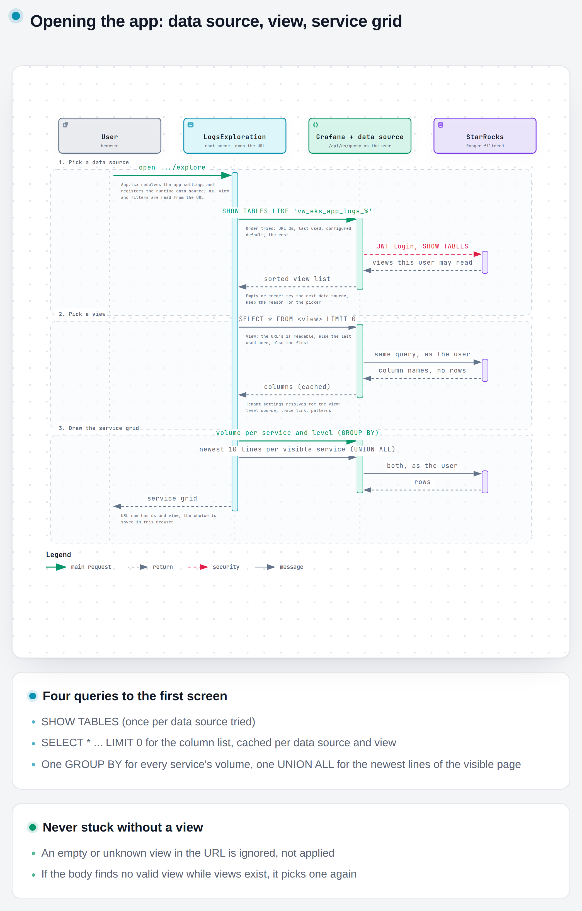
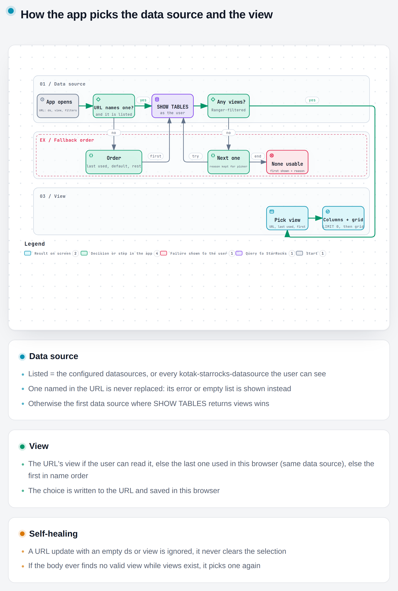
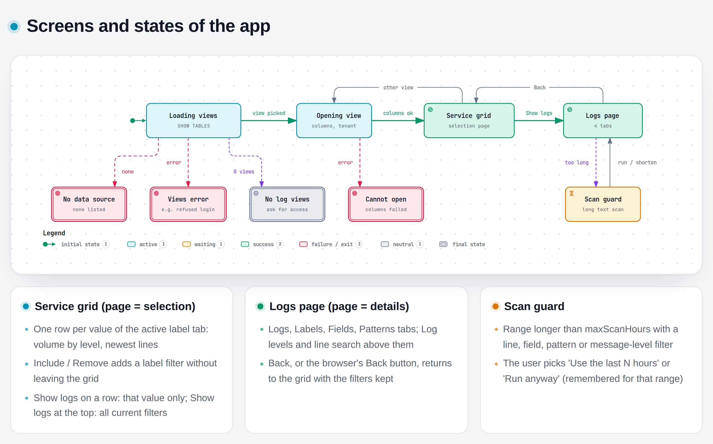

# 4. Opening the app and moving around

[Index](README.md) · Previous: [Code and scenes](03-code-and-scenes.md) · Next: [Queries](05-queries.md)

## From click to first screen



Four queries, all run as the user, stand between opening the app and the service grid:

1. `SHOW TABLES LIKE 'vw_eks_app_logs_%'` on the chosen data source. It runs again for each data source
   the app has to try.
2. `SELECT * FROM <view> LIMIT 0` returns the column names. No rows are read, and the result is cached per
   data source and view.
3. One `GROUP BY` gives the volume of **every** service, per time bucket and level.
4. One `UNION ALL` gives the newest 10 lines of each service **on the visible page**.

`DESCRIBE`, `SHOW COLUMNS` and `information_schema` are denied by Ranger, hence `LIMIT 0` for the columns.

## Picking the data source and the view



### Which data sources are offered

- `datasources` from the settings (in that order), or
- every instance of `kotak-starrocks-datasource` the user can see, sorted by name. The list comes from
  Grafana's data source list in the browser (`getList({pluginId})`), not from a query.
- In Grafana OSS every org user sees every data source. **The picker is not access control**; Ranger is.

### Which data source is opened

1. **The URL names one that is listed**: use it, with no fallback. If it fails, the error is shown and
   the user can switch.
2. **Otherwise**, try in this order, skipping duplicates and anything not listed:
   1. the last one used in this browser;
   2. the configured `datasourceUid`;
   3. the rest of the list.

   The first data source where `SHOW TABLES` returns at least one view wins. For each one that fails, the
   reason ("no log views for you", or the error) is kept and shown next to it in the picker.
3. **None usable**: show the first one in the order, with its error or "No log views available".

### Which view is opened

1. the URL's `view`, if this user can read it;
2. else the last view used in this browser, if it was in the same data source and is still readable;
3. else the first view in name order.

The choice is written to the URL and saved in the browser (`kotak-starrocks-logs-app:last`).

### Why it can never get stuck on "Opening view…"

- A URL update with an **empty or missing** `ds` or `view` is ignored. It does not clear the current choice.
  Such an update can arrive while the app is still picking.
- If the body is built and the view is not set or not in the list, while views exist, it **picks again**.
- Out-of-date answers are dropped. Each load gets a request number, and only the latest one may update the
  screen.

## Screens and states



| State | Shown when |
|---|---|
| Loading views | the views list is not known yet |
| Views error | `SHOW TABLES` failed, e.g. "StarRocks refused the connection" |
| No log views | `SHOW TABLES` returned none for this user |
| Opening view | the column list is loading |
| Cannot open | the column query failed |
| Service grid | page `selection` |
| Logs page | page `details`, one of 4 tabs |
| Scan guard | the range is too long for a text scan ([Performance](10-performance.md)) |

## The header (both pages)

Left: **Labels**, the "Filter by label values" box, then **Show logs** (grid) or **Back to service values**
(logs page). Right: **Data source**, **View**, the time picker (quick ranges from 5 minutes to 24 hours),
zoom out, and refresh. On a narrow window the right group wraps under the filters.

### The label filter box

This is a Scenes `AdHocFiltersVariable` in combobox mode, the same control as in Loki's Logs Drilldown.

- **Keys**: the view's label columns plus its field columns (`labels` and `fields` that exist in the view).
- **Operators**: `=`, `!=`, `=|` (one of), `!=|` (not one of), `=~` (regex), `!~`. The Scenes defaults `<`
  and `>` are removed because the columns are text.
- **Values**: when a key is picked, the app runs:

  ```sql
  SELECT <key> AS v, COUNT(*) AS c FROM <view>
  WHERE $__timeFilter(observed_timestamp)
    AND <all other filters, except those on this key>
    AND <key> != ''
  GROUP BY <key> ORDER BY c DESC LIMIT 200
  ```

  So the drop-down lists the 200 most frequent values **in the time range, under the other filters**. A
  value can also be typed.
- **Apply mode is manual.** The app reacts to filter changes itself, and rebuilds only when the change
  matters (see below).
- **In the URL** as `var-filters` (one entry per filter). An old 0.1.0 `filter=` link is converted once,
  and opens the logs page.
- **Semantics**: see [Queries → label filters](05-queries.md#label-filters).

## The service grid

- **Tabs**: "service" (the `serviceLabel`, `k8s_service_name` by default) plus any label added with **+ Add
  label**. Added tabs can be closed. Closing the active tab goes back to "service". The tab list is in the
  URL (`tabs`, `label`).
- **The grid ignores filters on its own label.** It always lists every value, so Include does not make the
  other rows disappear.
- **One row per value**, sorted by total lines in the range. Favourites come first, by the order at load
  time, so starring does not move rows around.
- Each row shows:
  - a **stacked bar chart** by level (error, warn, info, debug, unknown), with a legend table of totals;
  - the **newest 10 lines** of that value;
  - **★**: favourite, saved per browser, data source, view and tab;
  - **Include**: adds `<label> = <value>` to the filter box, and the button becomes **Remove**. Including
    several values of the same label means "any of them" (`IN (…)`);
  - **Show logs**: opens the logs page for **this value only**. Other `=` filters on the same label are
    replaced; filters on other labels are kept.
- **Show logs** in the header opens the logs page with **all current filters**.
- **Search services**: a drop-down that filters rows by substring, case-insensitive, and lists matches
  with their line counts. Picking one keeps only rows containing that text. Searching runs no query.
- **Showing N of M** with page size 10, 20, 50 or 100 (default 20), and pages. A page change fetches the
  newest lines for the new page only. The volumes are already loaded.

## The logs page

- Header filters: **Log levels** (none or all selected = no level filter) and **Search in log lines**, with
  `Aa` (match case), `.*` (regex), **Include** and **Exclude**. Line, pattern and field filters appear as
  removable chips.
- Tabs: **Logs**, **Labels**, **Fields**, **Patterns**
  ([Logs](07-logs-context-scroll.md), [Labels, fields, patterns](08-labels-fields-patterns.md)). The
  counters show how many label columns, field columns and configured patterns there are.
- **Back to service values** returns to the grid with all filters kept. Browser Back does the same.

## When something changes

| Action | Effect |
|---|---|
| Include/Remove on the grid's own label | URL updates; no query; row buttons update |
| Any other filter change | breakdown selection cleared; body rebuilt; new queries |
| Switch view | page back to the grid; levels, line, pattern, field and label filters cleared |
| Switch data source | as for a view, plus grid tabs reset; views listed again |
| Time range change | panels re-run; scan guard re-checked |

## URL examples

```
/a/kotak-starrocks-logs-app/explore
  ?ds=app-logs-starrocks-db
  &view=vw_eks_app_logs_app_1961_observability
  &page=details
  &var-filters=k8s_service_name|=|otel-collector
  &level=error
  &from=now-1h&to=now
```

That link opens the logs of `otel-collector` at level error for the last hour, for anyone who can read
the view. Anyone who cannot gets the reason instead.
