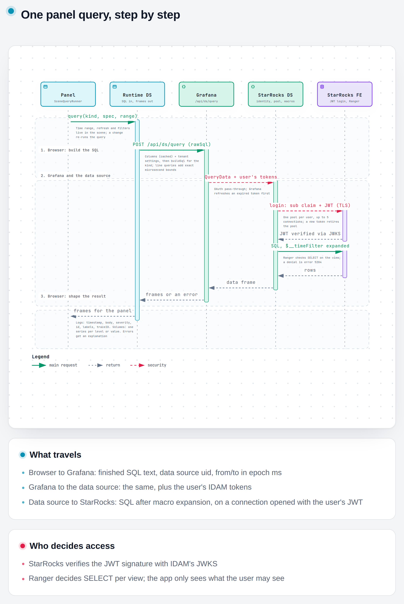

# 5. Queries: every SQL statement and how it is built

[Index](README.md) · Previous: [Opening and navigating](04-opening-and-navigating.md) · Next: [Time](06-time.md)

All SQL comes from one file, `src/sql/builder.ts`. The examples below are its **real output**, with long
pieces shortened as noted. `<level>` stands for the level expression shown first.

## The path of a query



What leaves the browser is a POST to `/api/ds/query`:

```json
{
  "from": "1763643600000", "to": "1763647201000",
  "queries": [{
    "refId": "A",
    "datasource": { "type": "kotak-starrocks-datasource", "uid": "app-logs-starrocks-db" },
    "rawSql": "SELECT … WHERE $__timeFilter(`observed_timestamp`) …",
    "format": "table", "rawQuery": true
  }]
}
```

The data source's own frontend is bypassed on purpose. The SQL is sent exactly as built, with no Grafana
template-variable interpolation in the browser.

## The level expression

**Column tenants** read the `level` column and normalise it:

```sql
(CASE lower(trim(`level`))
   WHEN 'error' THEN 'error' WHEN 'err' THEN 'error' WHEN 'fatal' THEN 'error'
   WHEN 'critical' THEN 'error' WHEN 'crit' THEN 'error' WHEN 'severe' THEN 'error'
   WHEN 'panic' THEN 'error' WHEN 'emerg' THEN 'error' WHEN 'emergency' THEN 'error'
   WHEN 'alert' THEN 'error' WHEN 'e' THEN 'error' WHEN 'f' THEN 'error'
   WHEN 'warn' THEN 'warn' WHEN 'warning' THEN 'warn' WHEN 'w' THEN 'warn'
   WHEN 'info' THEN 'info' WHEN 'information' THEN 'info' WHEN 'notice' THEN 'info'
   WHEN 'i' THEN 'info'
   WHEN 'debug' THEN 'debug' WHEN 'fine' THEN 'debug' WHEN 'config' THEN 'debug'
   WHEN 'trace' THEN 'debug' WHEN 'verbose' THEN 'debug' WHEN 'finest' THEN 'debug'
   WHEN 'd' THEN 'debug' WHEN 't' THEN 'debug'
   ELSE 'unknown' END)
```

The buckets are the same as the StarRocks Application Logs dashboard, plus the glog single letters. A
simple `CASE x WHEN …` evaluates the raw value once.

**Message tenants** (level column empty, e.g. observability) put the extracted word in place of
`lower(trim(level))`:

```sql
lower(coalesce(
  nullif(regexp_extract(`message`, '(?i)\\blevel["\']?\\s*[=:]\\s*["\']?([a-z]+)', 1), ''),
  nullif(regexp_extract(`message`, '\\b(FATAL|ERROR|WARN|WARNING|INFO|DEBUG|TRACE)\\b', 1), ''),
  nullif(regexp_extract(`message`, '^([IWEF])[0-9]{4} ', 1), ''),
  ''))
```

The regexes are tried in order and the first match wins. They are RE2 (StarRocks), and the tenant can
replace them. This reads the whole message, which is why message-level queries count as **text scans**
([Performance](10-performance.md)).

## The WHERE clause

`whereClause(spec, ctx)` always starts with the time filter. It then adds, in this order:

1. label filters, grouped by column;
2. levels;
3. line filters;
4. message field filters;
5. pattern filters;
6. extra conditions from the caller (exact time bounds, `col != ''`, `col = value`).

Here is a real example with many filters:

```sql
$__timeFilter(`observed_timestamp`)
  AND `k8s_service_name` IN ('cmm-api', 'cmm-worker')
  AND `k8s_namespace_name` != 'kube-system'
  AND regexp(`k8s_pod_name`, concat('^(?:cmm-api-.*)', '$'))
  AND <level> IN ('error', 'warn')
  AND lower(`message`) LIKE '%timeout%'
  AND NOT (`message` LIKE '%/healthz%')
  AND regexp(`message`, 'order=[0-9]+')
  AND instr(`message`, '50%') > 0
  AND regexp(`message`, concat(
        '(^|[\\s{,;])"?status"?\\s*[=:]\\s*"?500("|\\s|,|;|}|', '$', ')'))
```

A filter on `bad name; DROP` was in the input. It is **not** in the output, because names that are not
plain identifiers or not columns of the view are dropped.

### Label filters

| UI | SQL |
|---|---|
| one `=` on a column | `` `col` = 'v' `` |
| several `=` on the same column (Include twice, or `=\|`) | `` `col` IN ('a', 'b') `` (any of) |
| `!=` (and each value of `!=\|`) | `` `col` != 'v' `` (all must hold) |
| `=~` regex | `` regexp(`col`, '^(?:re)$') `` (whole value must match) |
| `!~` | `` NOT regexp(`col`, '^(?:re)$') `` |

Filters on different columns are joined with AND.

### Levels

`<level> IN ('error', 'warn')`. No level selected, or all five, means no condition.

### Line filters ("Search in log lines")

| Options | SQL |
|---|---|
| default (any case) | `` lower(`message`) LIKE '%text%' `` (text lower-cased) |
| `Aa` match case | `` `message` LIKE '%text%' `` |
| text contains `%`, `_` or `\` | `` instr(<message or lower(message)>, 'text') > 0 `` |
| `.*` regex | `` regexp(`message`, 're') ``, or `'(?i)re'` for any case |
| Exclude | `NOT (…)` around any of the above |

`instr()` is used because StarRocks 4.0 does not match an escaped `\%` at the end of a LIKE pattern, which
was found in testing. Several line filters are joined with AND.

### Message field filters (`status=500` inside the line)

```text
(^|[\s{,;])"?status"?\s*[=:]\s*"?500("|\s|,|;|}|$)
```

This matches `status=500`, `status: 500`, `"status":"500"` and `"status": 500`. The key and value are
regex-escaped. `!=` wraps it in `NOT`.

### Pattern filters

Included patterns are OR'ed together, `(p1 OR p2)`; each excluded one adds `AND NOT (p)`. A pattern is
`` `message` LIKE '<like>' `` or `` regexp(`message`, '<regex>') ``, from the tenant's settings. Unknown
names are ignored.

## Safety in the builder

- **Identifiers**: `quoteIdent` only accepts `^[A-Za-z_][A-Za-z0-9_]*$` and wraps it in backticks. Anything
  else throws. Filters on columns not in the view are dropped.
- **Values**: `lit()` makes a MySQL-style string literal, with `\` and `'` escaped.
- **`$` in values**: the data source expands `$name(...)` macros and `$__interval` **anywhere in the SQL,
  even inside quotes**. So a value with `$` is emitted as `concat('cost ', '$', '100 it\'s')`, and the macro
  engine never sees `$` followed by a name. StarRocks folds the constant.
- **Numbers** (limits, buckets) are floored integers, never strings.

## Every statement

### Views (picker)

```sql
SHOW TABLES LIKE 'vw_eks_app_logs_%'
```

The result is filtered by Ranger to what the user may read. The app keeps names starting with the prefix
and sorts them.

### Columns

```sql
SELECT * FROM `vw_eks_app_logs_app_1961_observability` LIMIT 0
```

This returns field names only. If it comes back empty, the app falls back to the known 21-column schema.

### Service grid volume (kind `serviceVolume`)

```sql
SELECT (UNIX_TIMESTAMP(`observed_timestamp`) DIV 30) * 30 AS t,
       `k8s_service_name` AS v, <level> AS lvl, COUNT(*) AS c
FROM `vw_eks_app_logs_app_01996_frontlineplatforms_cmm`
WHERE $__timeFilter(`observed_timestamp`)
GROUP BY t, v, lvl
ORDER BY t
```

There is one query for all services. The browser makes one series per (value, level), filling empty
buckets with 0, and sorts values by total. When the level split is skipped (a message tenant on a long
range), `<level>` becomes the constant `'all'`.

### Newest lines per grid row (kind `serviceSamples`)

```sql
(SELECT `observed_timestamp`, CAST(`observed_timestamp` AS VARCHAR) AS __ts,
        `message`, <level> AS detected_level,
        `k8s_service_name`, `k8s_namespace_name`, `k8s_pod_name`, `k8s_pod_uid`,
        `k8s_service_name` AS __value
 FROM `vw_…_cmm`
 WHERE $__timeFilter(`observed_timestamp`) AND `k8s_service_name` = 'cmm-api'
 ORDER BY `observed_timestamp` DESC LIMIT 10)
UNION ALL
(… the same for 'cmm-worker' …)
```

There is one branch per value on the visible page (up to the page size). Each branch is a small top-10
(`ORDER BY … LIMIT 10`, a TopN in StarRocks). `__value` tells the browser which row a line belongs to.

### Log lines (kinds `logs` and `table`)

```sql
SELECT `observed_timestamp`, CAST(`observed_timestamp` AS VARCHAR) AS __ts,
       `message`, <level> AS detected_level,
       `k8s_service_name`, `k8s_namespace_name`, `k8s_pod_name`, `k8s_pod_uid`
FROM `vw_…_cmm`
WHERE $__timeFilter(`observed_timestamp`)
  AND `k8s_service_name` = 'cmm-api'
  AND `observed_timestamp` >= microseconds_add(FROM_UNIXTIME(1763643600), 0)
  AND `observed_timestamp` < microseconds_add(FROM_UNIXTIME(1763647200), 1000)
ORDER BY `observed_timestamp` DESC
LIMIT 1000
```

- The selected columns are the label and field columns present in the view, without the time, message
  and level columns. The real list has all 12 labels and 4 fields; it is shortened here.
- `__ts` is the exact time as text, with microseconds. It is used by Show context and for line ids.
- The two exact bounds and the whole-second macro range are explained in [Time](06-time.md).

### Log volume histogram (kind `volume`)

```sql
SELECT (UNIX_TIMESTAMP(`observed_timestamp`) DIV 30) * 30 AS t,
       <level> AS g, COUNT(*) AS c
FROM `vw_…_cmm`
WHERE $__timeFilter(`observed_timestamp`) AND `k8s_service_name` = 'cmm-api'
GROUP BY t, g
ORDER BY t
```

### Values drop-down (label filter box)

```sql
SELECT `k8s_namespace_name` AS v, COUNT(*) AS c
FROM `vw_…_cmm`
WHERE $__timeFilter(`observed_timestamp`)
  AND `k8s_service_name` = 'cmm-api'      -- other filters kept
  AND `k8s_namespace_name` != ''          -- filters on this key dropped
GROUP BY `k8s_namespace_name`
ORDER BY c DESC
LIMIT 200
```

### Labels or Fields overview (kind `labelOverview`)

```sql
SELECT t, `k8s_service_name`, `k8s_namespace_name`,
       GROUPING_ID(`k8s_service_name`, `k8s_namespace_name`) AS gid, COUNT(*) AS c
FROM (SELECT (UNIX_TIMESTAMP(`observed_timestamp`) DIV 30) * 30 AS t,
             `k8s_service_name`, `k8s_namespace_name`
      FROM `vw_…_cmm`
      WHERE $__timeFilter(`observed_timestamp`)) s
GROUP BY GROUPING SETS ((t, `k8s_service_name`), (t, `k8s_namespace_name`))
```

**One scan for all columns**: the real query lists every label column. How `gid` is decoded is in
[Labels, fields, patterns](08-labels-fields-patterns.md).

### One column's values (kind `valueBreakdown`)

```sql
SELECT (UNIX_TIMESTAMP(`observed_timestamp`) DIV 30) * 30 AS t,
       `k8s_namespace_name` AS v, COUNT(*) AS c
FROM `vw_…_cmm`
WHERE $__timeFilter(`observed_timestamp`) AND `k8s_namespace_name` != ''
GROUP BY t, v
ORDER BY t
```

The browser keeps the top 30 values by total.

### A key=value field's values (kind `fieldBreakdown`)

```sql
SELECT t, v, COUNT(*) AS c
FROM (SELECT (UNIX_TIMESTAMP(`observed_timestamp`) DIV 30) * 30 AS t,
             regexp_extract(`message`,
               '(^|[\\s{,;])"?status"?\\s*[=:]\\s*"?([^"\\s,;}]+)', 2) AS v
      FROM `vw_…_observability`
      WHERE $__timeFilter(`observed_timestamp`)) s
WHERE v != ''
GROUP BY t, v
ORDER BY t
```

### Patterns (kind `patterns`)

```sql
SELECT (UNIX_TIMESTAMP(`observed_timestamp`) DIV 30) * 30 AS t,
  CASE
    WHEN `message` LIKE '%upstream timed out%' THEN 'Upstream timed out'
    WHEN regexp(`message`, 'Connection refused to [a-z0-9-]+:[0-9]+') THEN 'Connection refused'
    ELSE '' END AS p,
  COUNT(*) AS c
FROM `vw_…_observability`
WHERE $__timeFilter(`observed_timestamp`)
GROUP BY t, p
ORDER BY t
```

All patterns are counted in one scan. A line counts for the **first** pattern it matches, and `''`
(shown as "(unmatched)") is the rest. Pattern filters are **not** applied in this query, so the counts
stay visible while patterns are included or excluded.

### Show context (one per direction)

```sql
SELECT <same columns as log lines>
FROM `vw_…_cmm`
WHERE `k8s_pod_uid` = 'a0cdaf3d-8972-a946-168f-adb7763f115b'
  AND `observed_timestamp` < CAST('2026-11-20 13:25:15.852430' AS DATETIME)
  AND `observed_timestamp` >= DATE_SUB(CAST('2026-11-20 13:25:15.852430' AS DATETIME),
                                       INTERVAL 1 HOUR)
ORDER BY `observed_timestamp` DESC
LIMIT 100
```

The forward query uses `>`, `DATE_ADD` and `ASC`. Details are in
[Logs, context, scrolling](07-logs-context-scroll.md).

## From rows to panels (`datasource/frames.ts`)

| Kind | Frames |
|---|---|
| `logs`, `serviceSamples` | Grafana **log-lines** frame: `timestamp`, `body`, `severity`, `id`, `labels`, hidden `__ts`, and `traceID` when the tenant has a trace regex |
| `table` | the rows as a table, without `__ts` and `__value` |
| `volume` | one time series per level, in the order error, warn, info, debug, unknown |
| `serviceVolume` | one series per (value, level); each frame carries the value and its total |
| `labelOverview` | per column, top 5 values as series, plus the column's distinct count |
| `valueBreakdown`, `fieldBreakdown` | top 30 values as series |
| `patterns` | one series per pattern; `''` becomes "(unmatched)" |

Every frame carries the executed SQL in `meta.executedQueryString`. Time
series have a point for **every bucket in the range**, with zeros where there were no rows, so stacked bars
line up.
