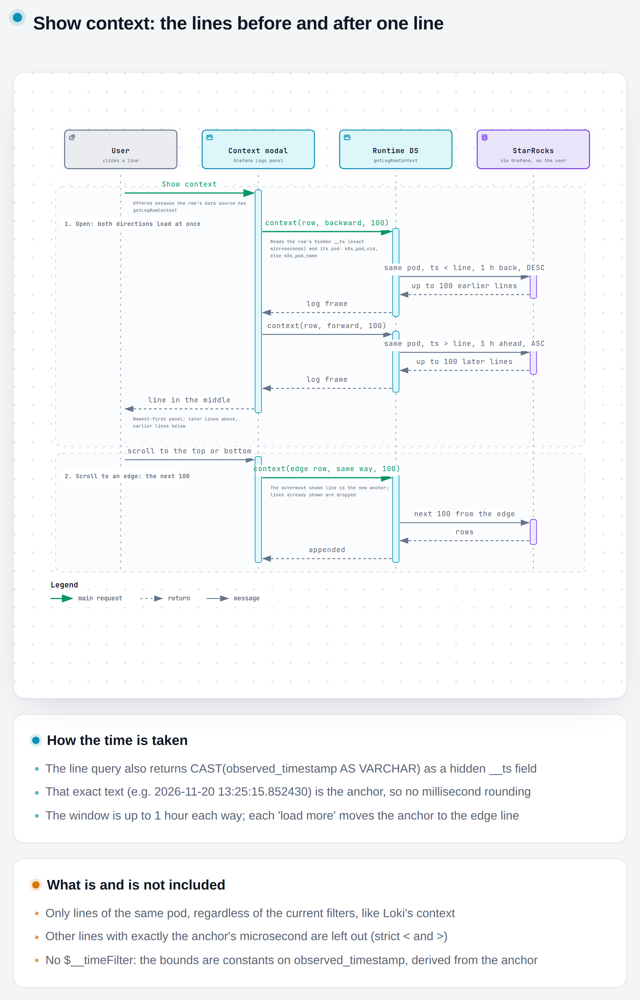
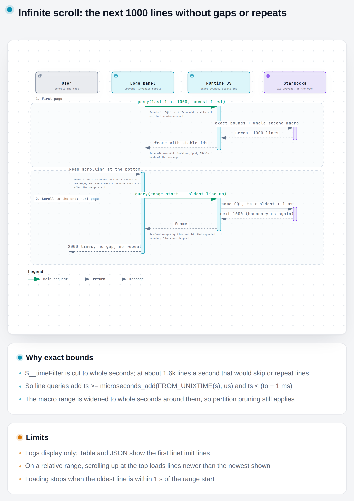

# 7. Logs tab, Show context, infinite scroll

[Index](README.md) · Previous: [Time](06-time.md) · Next: [Labels, fields, patterns](08-labels-fields-patterns.md)

## The Logs tab

From top to bottom:

1. **Log volume**: stacked bars per level over the range (kind `volume`). For a message tenant on a long
   range, a single "all" series instead (no level split), with a **Split by level anyway** button.
2. **Toolbar**:
   - **Newest first** / **Oldest first**: `ORDER BY … DESC/ASC`;
   - **line limit**: 100, 500, 1000, 2000 or 5000 (default `lineLimit`). It is also the page size for
     infinite scroll;
   - **Logs / Table / JSON**;
   - **Wrap lines** (Logs only);
   - **Open in Explore**: the `table` SQL for the current state, in a new tab;
   - **Copy link**: the current URL, which holds the whole state.
3. **The lines**, in Grafana's own **Logs panel**.

## What a log line carries

The runtime data source turns each row into a Grafana **log-lines** frame:

| Field | From | Used for |
|---|---|---|
| `timestamp` | `observed_timestamp` (ms) | the time column, ordering, paging |
| `body` | `message` | the line |
| `severity` | `detected_level` | the colour bar (error red, warn orange, info green, debug blue, unknown grey) |
| `id` | `<__ts>_<pod uid or name>_<FNV-1a of the message>` | identity across queries (infinite scroll) |
| `labels` | `detected_level` plus every non-empty label and field column | log details, filter buttons |
| `__ts` (hidden) | `CAST(observed_timestamp AS VARCHAR)` | Show context anchor |
| `traceID` | first capture group of the tenant's trace regex | **View trace** link to Tempo |

Identical lines in the same microsecond on the same pod get `#1`, `#2` suffixes, so ids stay unique.

## Log details and filter buttons

Click a line to open its details: every label, plus the trace id.

| Action | Effect |
|---|---|
| ⊕ on a label (filter for value) | adds `label = value` to the filter box |
| ⊖ on a label (filter out value) | adds `label != value` |
| ⊕ on `detected_level` | shows only that level (Log levels select) |
| ⊖ on `detected_level` | shows every level except that one |
| **View trace** | opens Explore on the tenant's Tempo data source with the trace id (TraceQL query `${__value.raw}`) |
| select text in a line | popover: "Add as line contains filter" / "does not contain" (exact, case-sensitive) |

A ⊕ that is already active shows as active, because the app tells the panel which filters exist.

### Trace links

- They are configured per tenant: `trace: {regex, tempoUid, linkTitle}`, usually generated from the Loki
  derived field of the same tenant.
- The regex runs **in the browser** on each loaded line. A leading `(?i)` becomes JavaScript's `i` flag.
- The link is an internal Grafana link: `datasourceUid = tempoUid`, the same shape Loki uses. Tempo must be
  in the same Grafana org.

## Table and JSON

- **Table**: the same SQL, with the rows as columns. Paging is by line limit; there is no infinite scroll.
- **JSON**: each line as an object with `timestamp`, `level`, `traceID`, `labels`, `message`, and
  `fields`. The message is parsed when it is a JSON object; otherwise its `key=value` pairs are extracted.
  The view shows 100 objects at a time, with **Show more**.
- **Open in Explore** opens the table SQL in Explore, with the app's data source and time range. Explore
  shows a **table**, not a logs view, because the data source returns table frames.

## Show context



**What the user sees.** Hover a line and pick **Show context**. A modal opens with that line in the middle,
the lines **before** it from the same pod below, and the lines **after** it above (in a newest-first
panel). Scrolling to the top or bottom loads more.

**Why the button is there.** Grafana's Logs panel offers Show context only if the line's data source
implements `getLogRowContext`. It finds that data source in **Grafana core's registry**, which is why the
app registers its runtime data source there too.

**What happens, precisely:**

1. The modal calls `getLogRowContext(row, {direction, limit: 100})` **for both directions at once**. The
   two loading markers, at the top and bottom, are visible when it opens.
2. The runtime data source reads, from the clicked row:
   - `__ts`: the exact time as text, e.g. `2026-11-20 13:25:15.852430`;
   - the pod: `k8s_pod_uid` if the line has one, else `k8s_pod_name`.

   Without either, it returns nothing.
3. **Backward** (earlier lines):

   ```sql
   WHERE `k8s_pod_uid` = '<pod>'
     AND `observed_timestamp` <  CAST('<__ts>' AS DATETIME)
     AND `observed_timestamp` >= DATE_SUB(CAST('<__ts>' AS DATETIME), INTERVAL 1 HOUR)
   ORDER BY `observed_timestamp` DESC LIMIT 100
   ```

   **Forward** (later lines): `>`, `DATE_ADD(…, INTERVAL 1 HOUR)`, `ASC`.
4. The rows become a log frame and the modal places them.
5. **Load more**: when the user scrolls to an edge, the modal calls `getLogRowContext` again with the
   **outermost line shown** in that direction. Its `__ts` becomes the new anchor, so each step reaches up
   to 100 lines or 1 hour further. Lines already shown are filtered out by the modal.

**Design choices and their effects:**

- **Same pod, all lines**: the current filters (service, level, search) are **not** applied, as in Loki,
  where context shows the stream around a line.
- **Anchor on the exact microsecond text**, not the millisecond `timestamp`. Otherwise lines in the same
  millisecond would be lost or repeated.
- **Strict `<` and `>`**: other lines with exactly the same microsecond as the anchor do not appear. With
  microsecond timestamps this is rare, and it never repeats a line.
- **One hour per step** keeps every context query on at most two hourly partitions. A pod silent for more
  than an hour before or after the line ends the context in that direction.
- **No `$__timeFilter`**: the bounds are constants derived from the anchor, and they do not depend on the
  session time zone.

## Infinite scroll



**What the user sees.** The first `lineLimit` lines (default 1000) load. Scrolling to the end of the list
loads the next 1000, and so on.

**Who does what:**

- The app enables it: `enableInfiniteScrolling` on the Logs panel. The Grafana feature toggle
  `logsInfiniteScrolling` is on by default in 12.0.1.
- **Grafana's Logs panel** decides when to load, and which range to ask for.
- The **runtime data source** runs the same query for that range.
- The panel **merges** the result into what it has.

**When it loads.** The panel loads more when:

- the user keeps scrolling with the list already at its bottom edge (a short chain of wheel or scroll
  events, so a single bump does not trigger it); and
- the oldest line shown is more than 1 second after the range start.

**Which range it asks for** (newest first):

```text
next range = { from: start of the time range, to: time of the oldest line shown (ms) }
```

With a relative range, scrolling up at the **top** asks for `{ from: newest line shown, to: now }`, which
loads lines that arrived since.

**Why it needs care on StarRocks:**

1. `$__timeFilter` works in whole seconds. If the next page were cut at a second boundary, lines in that
   second would be skipped or repeated.
2. The panel only knows times to the millisecond, and many lines share a millisecond.

**How the app makes the pages join exactly:**

- **Exact bounds**: `ts >= from` and `ts < to + 1 ms`, at microsecond precision
  ([Time](06-time.md#7-exact-bounds-on-line-queries)). The next page therefore **includes** the oldest
  millisecond of the previous page again, so nothing in it is lost.
- **Stable ids**: the panel merges by **time and `id`** (Grafana's `combineResponses`/`mergeFrames`, the
  same code Loki uses). Lines that come back a second time have the same id, and are dropped.
- **Whole-second macro range** around the exact bounds keeps partition pruning.

This was tested on real StarRocks. Two pages of 1000 contain exactly the lines of one 2500-line query down
to the second page's oldest millisecond: no gap, and overlap only at the boundary. The browser test
scrolls past 1000 lines and checks there are no duplicates.

**Limits:**

- Logs display only. Table and JSON show the first page.
- Each page is a full `ORDER BY … LIMIT` query over the remaining range. With a narrow filter on a long
  range, that can mean scanning far back to find the next 1000 lines.
- Scrolling up on a relative range loads only the newest `lineLimit` lines since the newest shown. If more
  arrived, the ones in between are not loaded. Loki behaves the same way.
