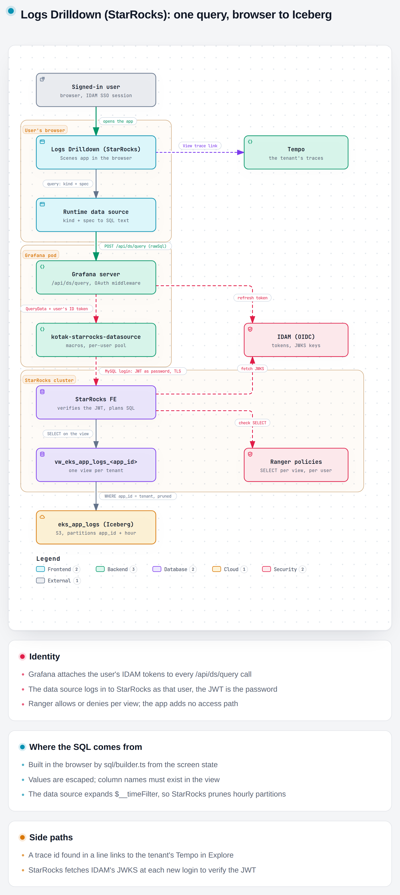

# Logs Drilldown (StarRocks): architecture guide

How every part of `kotak-starrocks-logs-app` works: what runs where, which SQL each screen sends, how
time is handled, how identity flows, and why it was built this way. It covers app version **0.3.0** at
commit `4107a6f`.

> **Reading on a phone:** tap a diagram to open it full screen, then pinch to zoom. Each diagram also exists
> as an interactive page in [`diagrams/interactive/`](diagrams/interactive). Download one and open it in a
> browser on a computer: you can click boxes, follow arrows, and jump to the source lines.

## The whole thing on one page

In one paragraph: the app is a **frontend-only Grafana app plugin**. It runs in the user's browser, turns
what is on screen into **SQL**, and sends that SQL to Grafana's `/api/ds/query` endpoint, addressed to the
unchanged **`kotak-starrocks-datasource`**. Grafana adds the user's IDAM token, and the data source logs in
to StarRocks **as that user**, with the token as the password. **Ranger** then allows or denies each view.
The app never sees data the user could not already query in Explore.

## Reading order

| # | Document | Answers |
|---|---|---|
| 1 | [Big picture](01-big-picture.md) | What it is, the parts, the path of one query, identity |
| 2 | [Going live](02-going-live.md) | Packaging, install, how Grafana loads it, configuration, tenants |
| 3 | [Code and scenes](03-code-and-scenes.md) | Where the code is, the scene tree, state, URL, caches |
| 4 | [Opening and navigating](04-opening-and-navigating.md) | Startup, picking data source and view, the screens, filters |
| 5 | [Queries](05-queries.md) | Every SQL statement, how the WHERE clause is built, escaping |
| 6 | [Time](06-time.md) | Time picker to SQL, time zones, microseconds, buckets |
| 7 | [Logs, context, scrolling](07-logs-context-scroll.md) | Log lines, details, trace links, Show context, infinite scroll |
| 8 | [Labels, fields, patterns](08-labels-fields-patterns.md) | Breakdowns, fields inside lines, patterns, suggestions |
| 9 | [Security](09-security.md) | Identity, Ranger, injection, what the app cannot do |
| 10 | [Performance](10-performance.md) | Queries per screen, guardrails, measured numbers |
| 11 | [When things go wrong](11-failure-modes.md) | Symptom, cause, where to look |
| 12 | [Decisions](12-decisions.md) | Every design decision, the alternatives, the reason |
| 13 | [Questions and answers](13-questions.md) | Discussion prep, from basic to deep |
| 14 | [Glossary](14-glossary.md) | Terms used in these documents |

## Ten facts to remember

1. **No backend in the app.** Grafana forwards the user's token only to data source plugins, so the SQL
   goes through `kotak-starrocks-datasource`, which is unchanged.
2. **The tenant is the view.** `vw_eks_app_logs_<app_id>`. Ranger decides who reads which view. The app's
   `tenants` settings only control display (level, trace link, patterns).
3. **Every screen is a few SQL queries.** The service grid is 2, the Logs tab 2, the Fields tab 2, Labels
   and Patterns 1 each.
4. **SQL is built in the browser** by `src/sql/builder.ts`. Column names must exist in the view, values are
   escaped, and `$` is split out so Grafana macros never touch user text.
5. **Time filter.** `$__timeFilter(observed_timestamp)` is expanded by the data source into
   `BETWEEN FROM_UNIXTIME(from) AND FROM_UNIXTIME(to)`, which lets StarRocks prune hourly Iceberg partitions.
6. **Line queries also carry exact microsecond bounds**, and each line gets a stable id. Together they let
   infinite scroll fetch the next 1000 lines with no gap and no repeat.
7. **Show context anchors on the line's exact microsecond timestamp**, kept in a hidden `__ts` field. It
   returns lines of the same pod up to one hour before and after, 100 at a time.
8. **Picking the view.** The URL's view if the user can read it, else the last view used in this browser,
   else the first. An empty URL value never clears the selection.
9. **Long text scans are guarded.** A range longer than `maxScanHours` with a text filter asks the user
   first, and the time picker stops at 24 hours.
10. **All screen state is in the URL**, so links can be shared and browser Back/Forward works. Only the last
    view and favourites live in the browser's localStorage.

## Diagrams in this guide

| File | Shows |
|---|---|
| [01-system](diagrams/01-system.png) | The parts and one query, browser to Iceberg |
| [02-startup](diagrams/02-startup.png) | Opening the app: the four queries to the first screen |
| [03-selection](diagrams/03-selection.png) | How the data source and view are chosen |
| [04-query](diagrams/04-query.png) | One panel query through Grafana and the data source |
| [05-context](diagrams/05-context.png) | Show context |
| [06-scroll](diagrams/06-scroll.png) | Infinite scroll |
| [07-config](diagrams/07-config.png) | Configuration, deploy-config to per-view settings |
| [08-screens](diagrams/08-screens.png) | Screens and states |
| [09-code](diagrams/09-code.png) | Code map |
| [10-scenes](diagrams/10-scenes.png) | Scene tree: who owns which query |

The diagrams were drawn with [Archify](https://github.com/tt-a1i/archify). Every box that names code links
to its file and lines at commit `4107a6f`. How to regenerate them:
[diagrams/tools](diagrams/tools/README.md).
